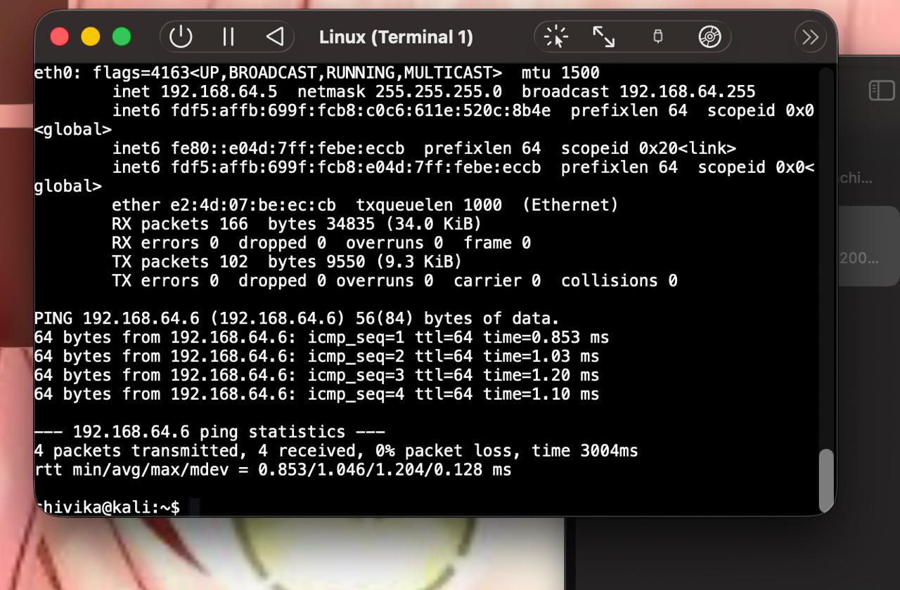
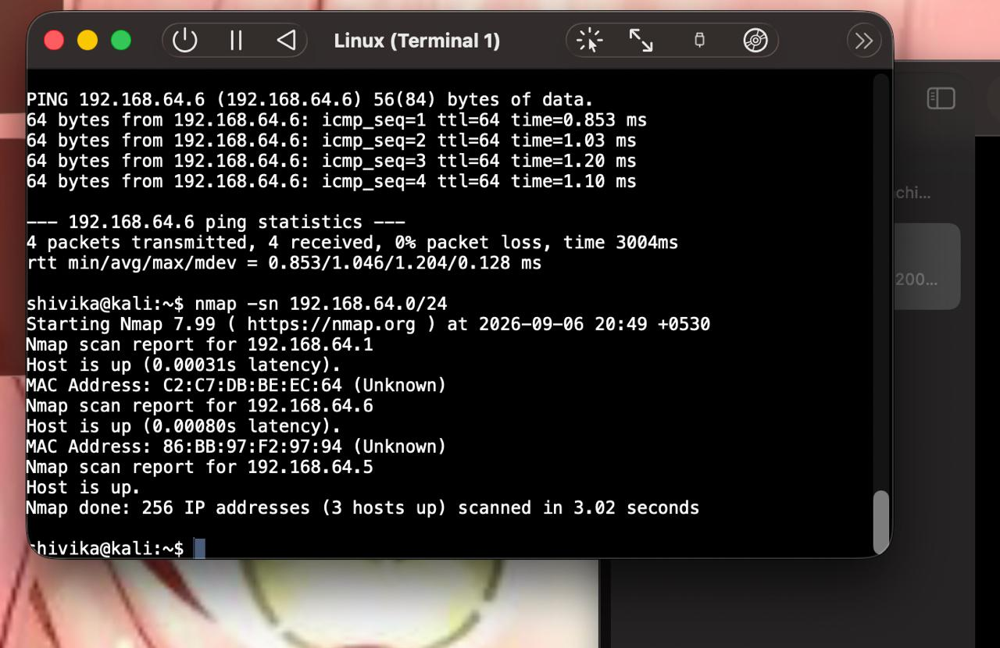
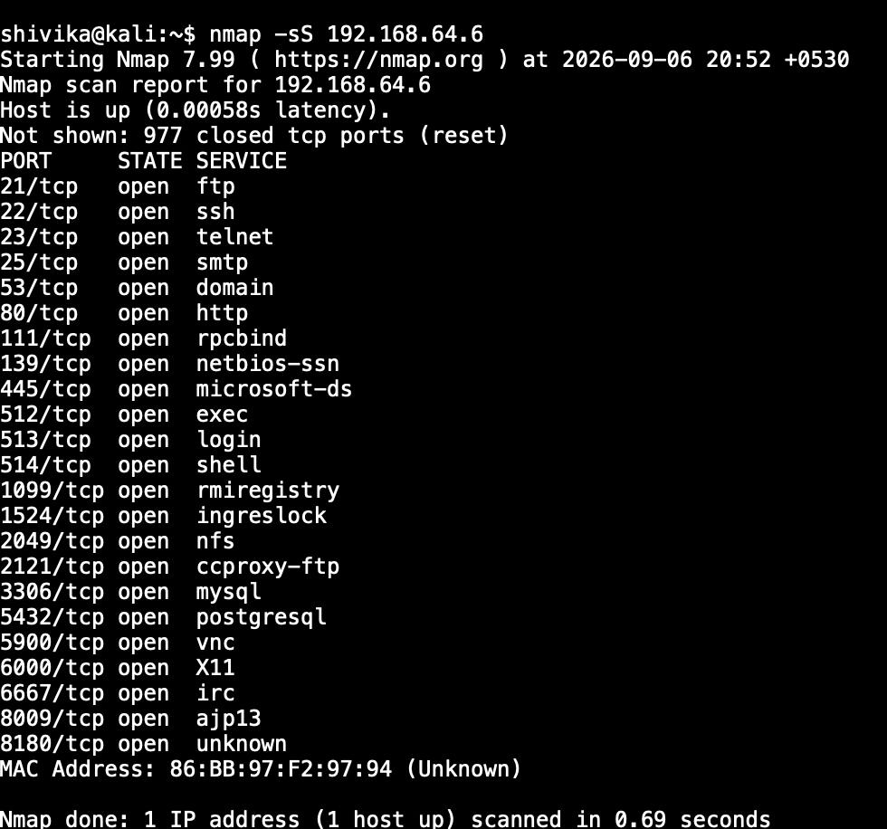
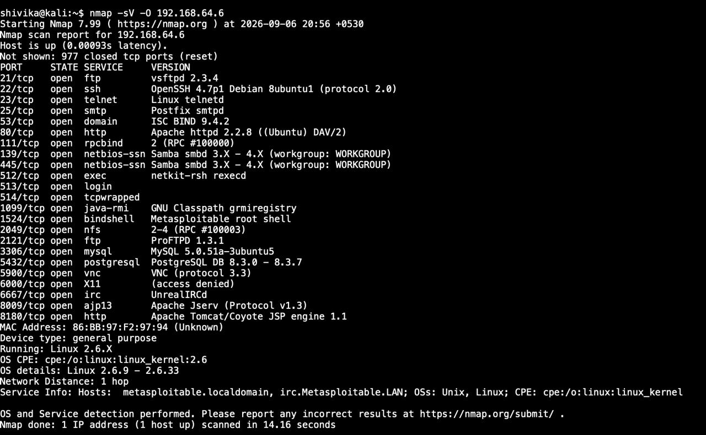
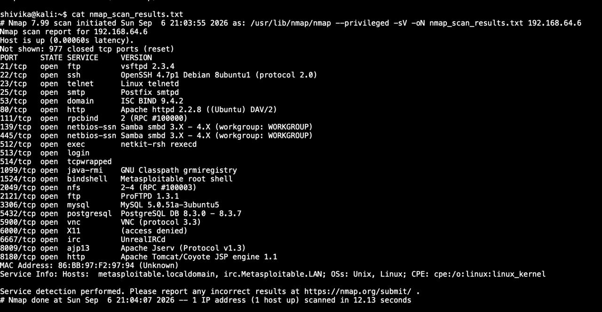
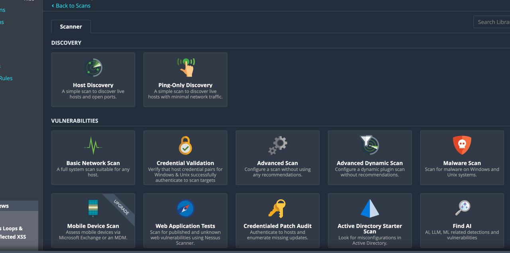
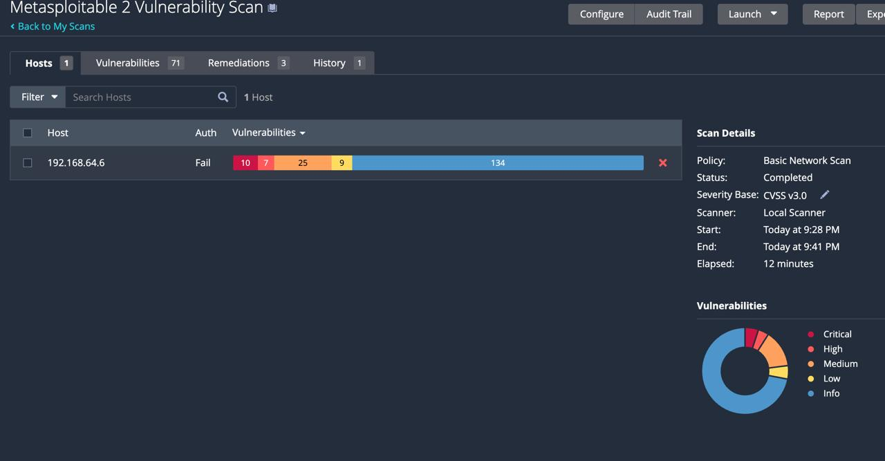
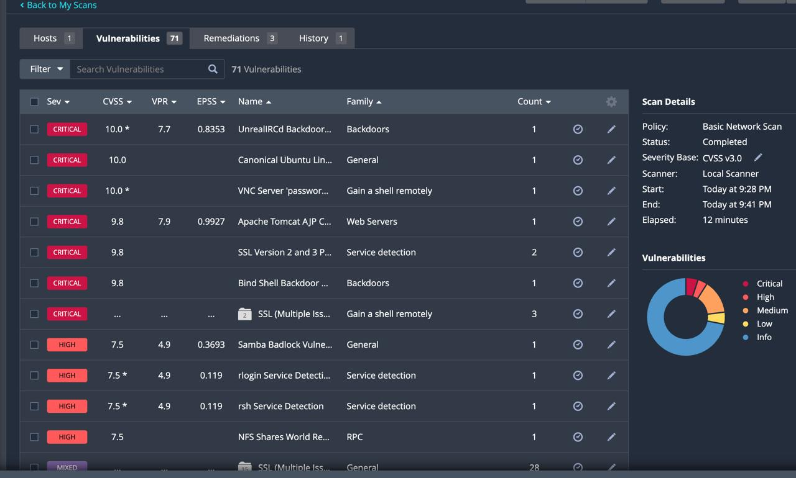
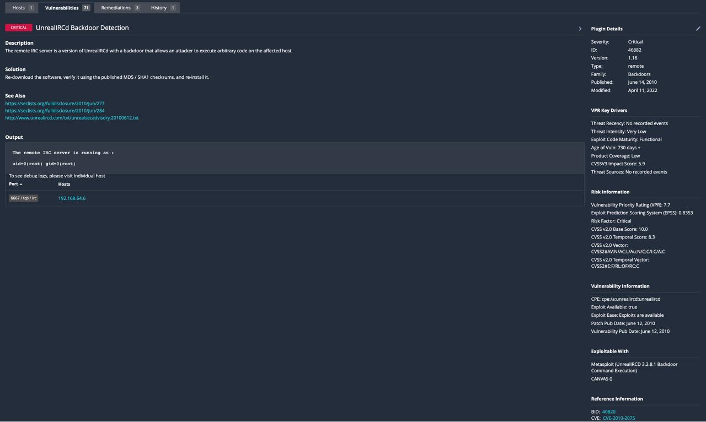

# Experiment 1: Scanning for Vulnerabilities using Nmap and Nessus

---

## Aim

To perform network reconnaissance by identifying active hosts and enumerating open ports using Nmap, and to conduct an automated vulnerability assessment of the target system using Nessus, thereby demonstrating the complementary roles of active scanning and vulnerability analysis in a penetration testing engagement.

---

## Requirements

| # | Component | Description |
|---|-----------|-------------|
| 1 | **Kali Linux** | Attacker machine (v2022.x or later) with Nmap pre-installed |
| 2 | **Metasploitable 2** | Intentionally vulnerable target VM (Ubuntu-based) |
| 3 | **Nessus Essentials** | Tenable's vulnerability scanner (free edition, up to 16 IPs) |
| 4 | **VirtualBox / VMware** | Type-2 hypervisor for hosting both VMs |
| 5 | **Host-Only Adapter** | Isolated virtual network segment (e.g., `192.168.64.0/24`) |

---

## Theory

### Network Scanning with Nmap

Nmap (Network Mapper) is the industry-standard open-source utility for network discovery and security auditing. At its core, Nmap crafts and sends raw IP packets to target hosts and interprets the responses to determine host availability, open ports, running services, operating system versions, and firewall/IDS configurations. The tool supports a wide range of scan techniques — from TCP SYN stealth scans (`-sS`), which send SYN packets and analyze RST/SYN-ACK replies without completing the three-way handshake, to full TCP connect scans (`-sT`), UDP scans (`-sU`), and advanced methods such as FIN, Xmas, and Idle scans. Nmap's service version detection engine (`-sV`) probes open ports with protocol-specific handshakes and matches responses against its `nmap-service-probes` database of over 11,000 signatures, while its OS fingerprinting module (`-O`) analyzes TCP/IP stack implementation quirks (initial TTL, window size, TCP options ordering) to identify the remote operating system.

### Vulnerability Assessment with Nessus

Nessus, developed by Tenable, is one of the most widely deployed vulnerability scanners in enterprise environments. It operates by executing a library of over 80,000 plugins — each a discrete check written in the Nessus Attack Scripting Language (NASL) — against target systems. Plugins range from simple banner-grabbing checks that match service version strings against known-vulnerable releases, to active exploitation checks that safely validate the presence of a flaw. Nessus categorises findings using the Common Vulnerability Scoring System (CVSS v3.1) and maps them to CVE identifiers, enabling seamless integration with patch management and risk prioritisation workflows.

### The Reconnaissance Phase in Context

In the PTES (Penetration Testing Execution Standard) methodology, the intelligence gathering and vulnerability analysis phases form the foundation upon which all subsequent exploitation activities rest. By combining Nmap's host and service enumeration with Nessus's automated vulnerability correlation, a tester can rapidly build an accurate attack surface map. This experiment targets Metasploitable 2, a deliberately insecure Linux distribution that ships with misconfigured services (e.g., vsftpd 2.3.4, UnrealIRCd 3.2.8.1) and known backdoors, making it an ideal candidate for demonstrating the full scanning workflow in a safe, isolated lab environment.

---

## Procedure

### Step 1: Identify the Attacker Machine's IP

Kali Linux IP was identified using `ifconfig`. Connectivity with the target was verified using:

```bash
ifconfig
ping -c 4 192.168.64.6
```

Kali IP: `192.168.64.5`  
Target IP: `192.168.64.6`

Ping was successful with 0% packet loss.



---

### Step 2: Discover Live Hosts

Live hosts were discovered using:

```bash
nmap -sn 192.168.64.0/24
```

> **Note:** The `-sn` flag (formerly `-sP`) performs a ping sweep — it sends ICMP echo requests, TCP SYN to port 443, TCP ACK to port 80, and ICMP timestamp requests to identify live hosts without performing a port scan.



---

### Step 3: Scan Open Ports

Open ports of the target were identified using:

```bash
nmap -sS 192.168.64.6
```

> **Note:** The SYN stealth scan (`-sS`) sends TCP SYN packets and classifies ports as *open* (SYN-ACK received), *closed* (RST received), or *filtered* (no response / ICMP unreachable). Because the three-way handshake is never completed, the scan is less likely to be logged by the target.



---

### Step 4: Service & OS Detection

Service versions and OS information were obtained using:

```bash
nmap -sV -O 192.168.64.6
```

> **Note:** `-sV` triggers version detection probes against each open port, while `-O` enables TCP/IP fingerprint-based OS detection using Nmap's `nmap-os-db` database.



---

### Step 5: Save Scan Results

The Nmap results were saved using:

```bash
nmap -sV -oN nmap_scan_results.txt 192.168.64.6
```

The file was verified using:

```bash
cat nmap_scan_results.txt
```

> **Tip:** Nmap supports multiple output formats: `-oN` (normal), `-oX` (XML for parsing), `-oG` (grepable), and `-oA` (all formats simultaneously).



---

### Step 6: Create Nessus Scan

Nessus Essentials was opened and Basic Network Scan was selected.



---

### Step 7: Configure & Launch Scan

A scan named `Metasploitable 2 Vulnerability Scan` was created with target `192.168.64.6`.

The scan was launched and completed successfully.



---

### Step 8: Review Vulnerabilities

Nessus identified vulnerabilities categorised as Critical, High, Medium, Low and Informational.



---

### Step 9: Document Key Finding

One critical finding was examined:

- **Vulnerability:** UnrealIRCd Backdoor Detection
- **CVE:** CVE-2010-2075
- **Port:** 6667/tcp
- **Host:** 192.168.64.6
- **Solution:** Re-download, verify and reinstall the software.

> **CVE-2010-2075 Details:** A malicious backdoor was introduced into the UnrealIRCd 3.2.8.1 source archive distributed between November 2009 and June 2010. The backdoor allows remote attackers to execute arbitrary commands by sending a crafted string beginning with `AB;` followed by a system command to the IRC daemon. CVSS v2 Base Score: **7.5 (High)**.



---

## Key Observations

| # | Observation | Detail |
|---|-------------|--------|
| 1 | Host Discovery | Nmap ping sweep successfully identified live hosts on the `192.168.64.0/24` subnet |
| 2 | Open Ports | Multiple high-risk ports were found open (21/FTP, 22/SSH, 23/Telnet, 80/HTTP, 6667/IRC, etc.) |
| 3 | Service Versions | Version detection revealed outdated and vulnerable service builds (e.g., vsftpd 2.3.4, OpenSSH 4.7p1) |
| 4 | OS Detection | Nmap fingerprinted the target as a Linux 2.6.x kernel host |
| 5 | Nessus Severity Breakdown | Critical and High findings dominated, confirming Metasploitable 2's intentionally insecure posture |
| 6 | Critical CVE | CVE-2010-2075 (UnrealIRCd backdoor) provides unauthenticated remote code execution on port 6667 |
| 7 | Scan Correlation | Nmap port/service data directly correlated with Nessus plugin findings, validating cross-tool consistency |

---

## MITRE ATT&CK Mapping

| Technique ID | Technique Name | Tactic | Relevance |
|--------------|---------------|--------|-----------|
| **T1046** | Network Service Scanning | Discovery | Nmap SYN scan and service version detection against the target |
| **T1018** | Remote System Discovery | Discovery | Nmap host discovery (`-sn`) sweep across the subnet |
| **T1082** | System Information Discovery | Discovery | OS fingerprinting via Nmap (`-O`) |
| **T1595.002** | Active Scanning: Vulnerability Scanning | Reconnaissance | Nessus automated vulnerability assessment |
| **T1190** | Exploit Public-Facing Application | Initial Access | UnrealIRCd backdoor (CVE-2010-2075) on externally accessible port |

---

## Defensive Recommendations

| # | Recommendation | Priority |
|---|---------------|----------|
| 1 | **Patch and Update Services** — Upgrade all services to their latest stable releases; remove or replace end-of-life software such as UnrealIRCd 3.2.8.1 | Critical |
| 2 | **Disable Unnecessary Services** — Shut down services not required for operations (e.g., Telnet, IRC) to reduce the attack surface | High |
| 3 | **Implement Network Segmentation** — Isolate sensitive hosts behind firewalls with explicit allow-list rules; deny inbound traffic to high-risk ports by default | High |
| 4 | **Deploy IDS/IPS** — Use intrusion detection systems (e.g., Snort, Suricata) to detect and alert on SYN scan patterns and known exploit signatures | Medium |
| 5 | **Enable Logging and Monitoring** — Configure centralised logging (syslog/SIEM) for all services to ensure scan and exploitation attempts are captured and reviewed | Medium |
| 6 | **Conduct Regular Vulnerability Scans** — Schedule periodic authenticated Nessus scans to identify and remediate newly disclosed vulnerabilities | Medium |
| 7 | **Verify Software Integrity** — Use cryptographic checksums (SHA-256) to validate downloaded software packages against vendor-published hashes before installation | Low |

---

## Result

The experiment successfully demonstrated the use of Nmap for network reconnaissance (host discovery, port scanning, service enumeration, and OS detection) and Nessus for automated vulnerability assessment. Nmap identified multiple open ports and services on the Metasploitable 2 target, and Nessus correlated these services against its vulnerability database, flagging several critical and high-severity findings including the UnrealIRCd backdoor (CVE-2010-2075).

---

## Conclusion

This experiment illustrated the critical first phases of a penetration testing engagement — reconnaissance and vulnerability analysis. By combining Nmap's flexible scanning capabilities with Nessus's extensive plugin library, a comprehensive picture of the target's attack surface was constructed. The findings reinforce the importance of proactive vulnerability management: regularly scanning for exposed services, correlating results with public vulnerability databases (CVE/NVD), and prioritising remediation based on severity and exploitability. In a real-world engagement, the data gathered in this phase would directly inform the exploitation strategy for subsequent testing phases.
