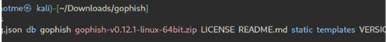
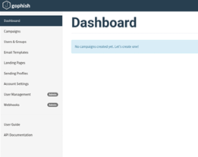
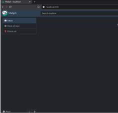
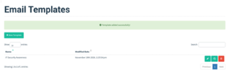
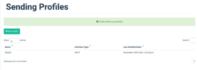
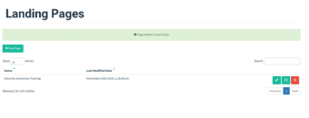
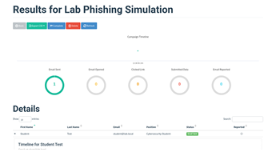

# 🎣 Experiment 10: Phishing Simulation with GoPhish

## Designing and Executing a Simulated Phishing Campaign Using the GoPhish Framework

---

## 📌 Aim

To design, configure, and execute a controlled phishing simulation campaign using the **GoPhish** framework — an open-source phishing toolkit — to understand the mechanics of phishing attacks, evaluate user susceptibility, and develop organizational awareness training strategies and technical countermeasures.

---

## 🧰 Requirements

| Component              | Specification                                           |
| :---------------------- | :------------------------------------------------------ |
| **Attack Machine**      | Kali Linux or Ubuntu (VM or bare-metal)                |
| **GoPhish**             | GoPhish v0.12+ (https://github.com/gophish/gophish)   |
| **SMTP Server**         | Local Postfix/sendmail, or SMTP relay (Mailtrap for testing) |
| **Target Email**        | Test email accounts (internal lab only)                |
| **Web Browser**         | Chrome / Firefox for GoPhish admin dashboard           |
| **Network**             | Isolated lab network (DO NOT target real users)        |
| **Optional**            | SSL certificate for landing pages, DNS for realism     |

---

## 📖 Theory

### Phishing — The #1 Attack Vector

Phishing is a social engineering attack that uses deceptive electronic communications — primarily email — to manipulate recipients into revealing sensitive information, downloading malware, or performing unauthorized actions. According to the Verizon Data Breach Investigations Report (DBIR), phishing is consistently involved in over 30% of all data breaches and remains the most common initial access vector for both opportunistic and advanced persistent threat (APT) campaigns. Phishing attacks range from mass-distributed generic lures ("spray and pray") to highly targeted spear-phishing campaigns that leverage OSINT to craft personalized, convincing messages directed at specific individuals. Variants include **vishing** (voice phishing), **smishing** (SMS phishing), **whaling** (targeting executives), and **business email compromise (BEC)** where attackers impersonate trusted parties to authorize fraudulent transactions.

### GoPhish Framework

GoPhish is an open-source, enterprise-grade phishing simulation framework designed for security professionals to test organizational resilience against phishing attacks. Written in Go, GoPhish provides a full-featured web-based admin dashboard for managing every aspect of a phishing campaign: **Sending Profiles** (SMTP configuration), **Email Templates** (customizable phishing emails with tracking pixels and links), **Landing Pages** (cloned or custom credential harvesting pages), **User Groups** (target lists), and **Campaigns** (orchestrating all components into a timed operation). GoPhish tracks detailed metrics including email open rates (via embedded tracking images), link click rates, credential submission rates, and email report rates — producing executive-ready reports that quantify organizational phishing susceptibility. Its modular architecture, REST API, and webhook support enable integration with security awareness training platforms, SIEM systems, and automated remediation workflows.

### Why Simulate Phishing?

Phishing simulations serve as both an assessment and a training tool. They establish a **baseline measurement** of organizational susceptibility, identify **high-risk user groups** (departments or roles most likely to fall for phishing), provide **teachable moments** through immediate feedback when users click malicious links, and enable **trend tracking** over time to measure the effectiveness of security awareness programs. Regulatory frameworks including NIST 800-53 (SI-5), ISO 27001 (A.7.2.2), PCI-DSS (12.6), and HIPAA (164.308) either require or strongly recommend regular phishing assessments. Unlike real attacks, simulations operate within ethical and legal boundaries — they use controlled infrastructure, do not exfiltrate real credentials, and include educational landing pages that train users at the moment of vulnerability.

---

## 🔬 Procedure

### Step 1 — Install GoPhish

Download and install the GoPhish binary on the attacker machine:

```bash
# Download the latest GoPhish release
wget https://github.com/gophish/gophish/releases/download/v0.12.1/gophish-v0.12.1-linux-64bit.zip

# Unzip the archive
unzip gophish-v0.12.1-linux-64bit.zip -d /opt/gophish

# Navigate to the GoPhish directory
cd /opt/gophish

# Make the binary executable
chmod +x gophish

# Review the configuration file
cat config.json
```

The default `config.json` configures:
- **Admin server:** `https://127.0.0.1:3333` (management dashboard)
- **Phish server:** `http://0.0.0.0:80` (serves landing pages to targets)

```json
{
  "admin_server": {
    "listen_url": "0.0.0.0:3333",
    "use_tls": true,
    "cert_path": "gophish_admin.crt",
    "key_path": "gophish_admin.key"
  },
  "phish_server": {
    "listen_url": "0.0.0.0:80",
    "use_tls": false
  },
  "db_name": "sqlite3",
  "db_path": "gophish.db"
}
```

> 📸 *GoPhish Installation & Setup*



---

### Step 2 — Launch GoPhish and Access the Dashboard

Start the GoPhish server and retrieve the initial admin password:

```bash
# Start GoPhish (output includes default admin password)
sudo ./gophish

# Look for output like:
# time="2024-01-01T00:00:00Z" level=info msg="Please login with the username admin and the password XXXXXXXX"
# time="2024-01-01T00:00:00Z" level=info msg="Starting admin server at https://0.0.0.0:3333"
# time="2024-01-01T00:00:00Z" level=info msg="Starting phishing server at http://0.0.0.0:80"
```

Open a browser and navigate to `https://localhost:3333`. Log in with:
- **Username:** `admin`
- **Password:** *(displayed in the terminal output on first run)*

Change the default password immediately upon first login.

> 📸 *GoPhish Admin Dashboard*



---

### Step 3 — Configure a Sending Profile (SMTP)

Set up the SMTP configuration that GoPhish will use to send phishing emails:

1. Navigate to **Sending Profiles** → **New Profile**
2. Configure the following fields:

| Field                  | Value (Lab Example)                                |
|:-----------------------|:---------------------------------------------------|
| **Name**               | Lab SMTP Profile                                   |
| **SMTP From**          | `security@company-internal.lab`                    |
| **Host**               | `localhost:25` (local Postfix) or `smtp.mailtrap.io:2525` |
| **Username**           | *(SMTP username if required)*                      |
| **Password**           | *(SMTP password if required)*                      |
| **Ignore Cert Errors** | ✅ (for lab environments)                           |

For a local SMTP server setup:

```bash
# Install Postfix as a local mail relay
sudo apt install postfix -y

# Configure as "Local only" during installation
# Verify Postfix is running
sudo systemctl status postfix

# Test email delivery
echo "Test email body" | mail -s "Test Subject" testuser@localhost
```

Click **Send Test Email** to verify the configuration works before proceeding.

> 📸 *Sending Profiles Configuration*



> 📸 *MailHog / SMTP Capture Interface*



---

### Step 4 — Create an Email Template

Design the phishing email that targets will receive:

1. Navigate to **Email Templates** → **New Template**
2. Configure the template:

| Field              | Value                                                          |
|:-------------------|:---------------------------------------------------------------|
| **Name**           | Password Reset Notification                                    |
| **Subject**        | `[Action Required] Your password expires in 24 hours`          |
| **Add Tracking Image** | ✅ Enabled (tracks email opens)                            |

3. In the **HTML** editor, create a convincing email body:

```html
<html>
<body style="font-family: Arial, sans-serif; margin: 20px;">
  <div style="max-width: 600px; margin: 0 auto; border: 1px solid #ddd; padding: 20px;">
    
    <hr>
    <h2 style="color: #333;">Password Expiration Notice</h2>
    <p>Dear {{.FirstName}},</p>
    <p>Our security system has detected that your account password will expire in
       <strong>24 hours</strong>. To avoid disruption to your access, please update
       your password immediately by clicking the button below.</p>
    <p style="text-align: center; margin: 30px 0;">
      <a href="{{.URL}}" style="background-color: #0066cc; color: white; padding: 12px 30px;
         text-decoration: none; border-radius: 5px; font-size: 16px;">
         Reset Password Now
      </a>
    </p>
    <p style="color: #666; font-size: 12px;">
      If you did not request this change, please contact the IT Help Desk at ext. 4357.<br>
      This is an automated message from the IT Security Team.
    </p>
  </div>
</body>
</html>
```

> **💡 Note:** GoPhish variables like `{{.FirstName}}`, `{{.LastName}}`, `{{.Email}}`, and `{{.URL}}` are automatically populated for each recipient.

> 📸 *Phishing Email Template Design*


---

### Step 5 — Create a Landing Page

Build the credential harvesting page that targets see when they click the phishing link:

1. Navigate to **Landing Pages** → **New Page**
2. Configure:

| Field                  | Value                                          |
|:-----------------------|:-----------------------------------------------|
| **Name**               | Password Reset Portal                          |
| **Capture Submitted Data** | ✅ Enabled                                 |
| **Capture Passwords**  | ✅ Enabled (lab only — stores in GoPhish DB)   |
| **Redirect To**        | `https://company-internal.lab/training`        |

3. Use **Import Site** to clone a realistic login page, or create one manually:

```bash
# GoPhish can clone an existing site:
# Click "Import Site" → Enter URL → Click "Import"
# This captures the HTML/CSS of the target login page
```

After a user submits credentials on this page, they are automatically redirected to the training/awareness page specified in the redirect URL.

> 📸 *Phishing Landing Page Portal*



---

### Step 6 — Define the Target User Group

Create a group of test recipients for the campaign:

1. Navigate to **Users & Groups** → **New Group**
2. Add test users manually or import via CSV:

```csv
First Name,Last Name,Email,Position
John,Doe,john.doe@lab.internal,Developer
Jane,Smith,jane.smith@lab.internal,Manager
Bob,Wilson,bob.wilson@lab.internal,Analyst
Alice,Brown,alice.brown@lab.internal,HR Specialist
```

```bash
# Save the above as targets.csv and import via the GoPhish UI
# Or add users individually through the web interface
```

> **⚠️ Warning:** In this lab, only use test email accounts that you control. Never send phishing simulations to real users without explicit organizational authorization and legal review.

> 📸 *Target Users and Groups Configuration*



---

### Step 7 — Launch the Phishing Campaign

Orchestrate all components into a live campaign:

| Field              | Value                          |
|:-------------------|:-------------------------------|
| **Name**           | Q4 Security Assessment Sim     |
| **Email Template** | Password Reset Notification    |
| **Landing Page**   | Password Reset Portal          |
| **Sending Profile**| Lab SMTP Profile               |
| **Groups**         | Lab Test Users                 |
| **URL**            | `http://<attacker-ip>`         |
| **Launch Date**    | Immediate or scheduled         |

3. Click **Launch Campaign** to begin sending phishing emails to the target group.

```bash
# Monitor GoPhish logs for email delivery status
tail -f /opt/gophish/gophish.log

# Verify emails are being sent
sudo tail -f /var/log/mail.log
```

---

### Step 8 — Monitor Campaign Results in Real-Time

Return to the campaign dashboard to monitor live metrics:

- **Emails Sent** — Total emails successfully delivered
- **Emails Opened** — Recipients who opened the email (tracking pixel fired)
- **Links Clicked** — Recipients who clicked the phishing link
- **Credentials Submitted** — Recipients who entered data on the landing page
- **Emails Reported** — Recipients who reported the phishing email

GoPhish provides a timeline view showing exactly when each action occurred, enabling analysis of user response patterns.

> 📸 *Phishing Simulation Campaign Results & Analytics*



```bash
# GoPhish also provides a REST API for programmatic monitoring
curl -k -H "Authorization: Bearer <api-key>" \
  https://localhost:3333/api/campaigns/?api_key=<api-key>

# Export campaign results
curl -k https://localhost:3333/api/campaigns/1/results?api_key=<api-key> | jq .
```

---

### Step 9 — Generate Reports and Analyze Results

After the campaign window closes, generate comprehensive reports:

1. Navigate to the campaign → **Complete Campaign** (to stop tracking)
2. Click **Export CSV** to download detailed results
3. Analyze metrics:

```bash
# Example analysis of exported CSV
# Calculate click-through rate
total_sent=100
total_clicked=35
click_rate=$(echo "scale=2; $total_clicked * 100 / $total_sent" | bc)
echo "Click-through rate: ${click_rate}%"

# Identify high-risk users (submitted credentials)
grep "Submitted Data" campaign_results.csv | wc -l
```

Key metrics to document:

| Metric                    | Formula                                  |
|:--------------------------|:-----------------------------------------|
| **Open Rate**             | (Emails Opened / Emails Sent) × 100     |
| **Click-Through Rate**    | (Links Clicked / Emails Sent) × 100     |
| **Credential Submit Rate**| (Creds Submitted / Emails Sent) × 100   |
| **Report Rate**           | (Emails Reported / Emails Sent) × 100   |

---

## 📊 Key Observations

| # | Observation                                 | Details                                                              |
|---|:--------------------------------------------|:---------------------------------------------------------------------|
| 1 | GoPhish provides end-to-end campaign mgmt   | Single framework handles email, landing pages, tracking, reporting   |
| 2 | Tracking pixel reveals email open behavior  | Invisible 1x1 image fires on email open, providing open metrics      |
| 3 | Template variables enable personalization   | `{{.FirstName}}` and similar tags increase phishing believability     |
| 4 | Credential capture demonstrates real risk   | Even in simulations, users enter real-looking credentials             |
| 5 | Redirect to training creates teachable moment | Immediate feedback reinforces security awareness                   |
| 6 | Time-of-day affects click rates             | Users are more susceptible during morning hours and after lunch       |
| 7 | Authority-themed lures have high success    | Emails impersonating IT, HR, or management see higher engagement     |

---

## 🗺️ MITRE ATT&CK Mapping

| Technique ID  | Technique Name                                        | Tactic             | Relevance                                                  |
|:--------------|:------------------------------------------------------|:-------------------|:-----------------------------------------------------------|
| **T1566**     | Phishing                                              | Initial Access     | Core technique — sending deceptive emails to targets       |
| **T1566.001** | Phishing: Spearphishing Attachment                    | Initial Access     | Variant with malicious attachments (not used here)         |
| **T1566.002** | Phishing: Spearphishing Link                          | Initial Access     | Phishing email containing credential harvesting link       |
| **T1598**     | Phishing for Information                              | Reconnaissance     | Harvesting credentials via fake login pages                |
| **T1598.003** | Phishing for Information: Spearphishing Link          | Reconnaissance     | Targeted credential phishing via link to landing page      |
| **T1204.001** | User Execution: Malicious Link                        | Execution          | User clicking the phishing link triggers the attack chain  |
| **T1056.003** | Input Capture: Web Portal Capture                     | Credential Access  | Capturing credentials submitted to the fake landing page   |
| **T1586**     | Compromise Accounts                                   | Resource Development | Using harvested credentials for further access            |
| **T1585.002** | Establish Accounts: Email Accounts                    | Resource Development | Creating spoofed email accounts for the campaign          |

---

## 🛡️ Countermeasures / Defensive Recommendations

| # | Recommendation                                        | Implementation Details                                                                              |
|---|:------------------------------------------------------|:----------------------------------------------------------------------------------------------------|
| 1 | **Security awareness training**                       | Regular (quarterly) phishing simulations with immediate feedback and training modules               |
| 2 | **Email gateway filtering**                           | Deploy SPF, DKIM, and DMARC records to prevent email spoofing; use mail gateways for URL scanning  |
| 3 | **URL and link protection**                           | Enable Safe Links (Microsoft 365) or similar URL rewriting and sandboxing services                 |
| 4 | **Multi-factor authentication (MFA)**                 | Even if credentials are phished, MFA prevents account compromise                                   |
| 5 | **Phishing report button**                            | Deploy a one-click "Report Phishing" button in email clients for rapid incident response           |
| 6 | **Browser-based protections**                         | Enable Google Safe Browsing, SmartScreen; deploy DNS-based filtering (Pi-hole, Cisco Umbrella)     |
| 7 | **Credential monitoring**                             | Monitor for leaked credentials on dark web forums using services like Have I Been Pwned            |
| 8 | **Email authentication (SPF/DKIM/DMARC)**             | `v=spf1 include:_spf.google.com -all` — reject unauthorized senders                               |
| 9 | **Incident response plan for phishing**               | Documented playbook: isolate account → reset credentials → scan for lateral movement → report      |
|10 | **Segment high-risk users**                           | Provide enhanced training for roles frequently targeted (finance, HR, executives)                  |

---

## ✅ Result

A complete phishing simulation campaign was designed and configured using the GoPhish framework. The experiment covered the full lifecycle of a phishing operation:

- **Infrastructure setup** — GoPhish installation, SMTP configuration, and server deployment
- **Campaign design** — Email template creation with urgency-based social engineering, credential harvesting landing page construction, and target group definition
- **Execution and monitoring** — Campaign launch with real-time tracking of email opens, link clicks, and credential submissions
- **Reporting** — Generation of actionable metrics (open rate, click-through rate, credential submission rate) for organizational security assessment

---

## 📝 Conclusion

This experiment demonstrated how GoPhish provides a comprehensive, ethical framework for simulating phishing attacks and measuring organizational susceptibility. The platform's ability to track granular user interactions — from email opens to credential submissions — produces actionable data for security awareness programs. Phishing remains the most prevalent initial access vector for cyberattacks, and regular simulations are essential for building a human firewall. Organizations should combine technical controls (email filtering, MFA, URL sandboxing, DMARC enforcement) with behavioral interventions (training, simulated phishing, incident response drills) to create a defense-in-depth strategy against social engineering threats. The data gathered from GoPhish campaigns directly informs risk-based training prioritization and security investment decisions.

---

> **⚠️ Disclaimer:** This experiment must only be performed in a controlled lab environment with test accounts. Conducting phishing simulations against real users requires explicit organizational authorization, legal review, HR coordination, and compliance with applicable laws. Unauthorized phishing is illegal.
