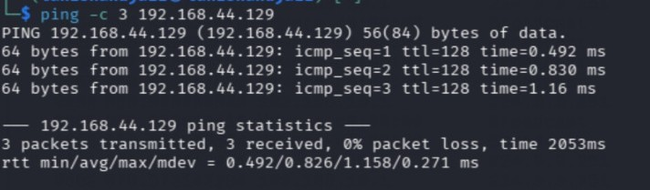
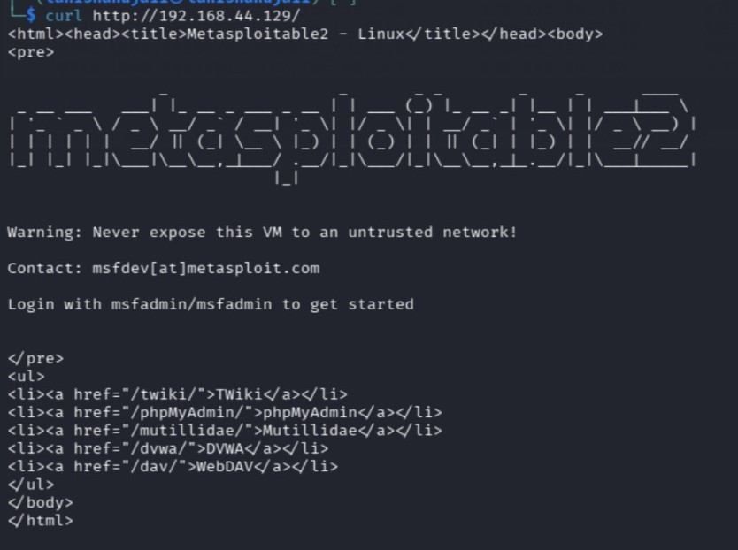
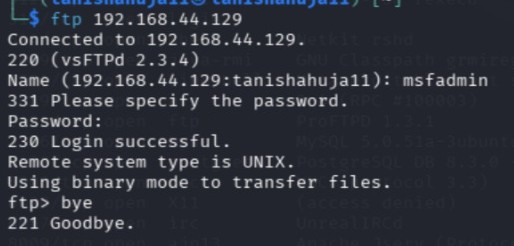
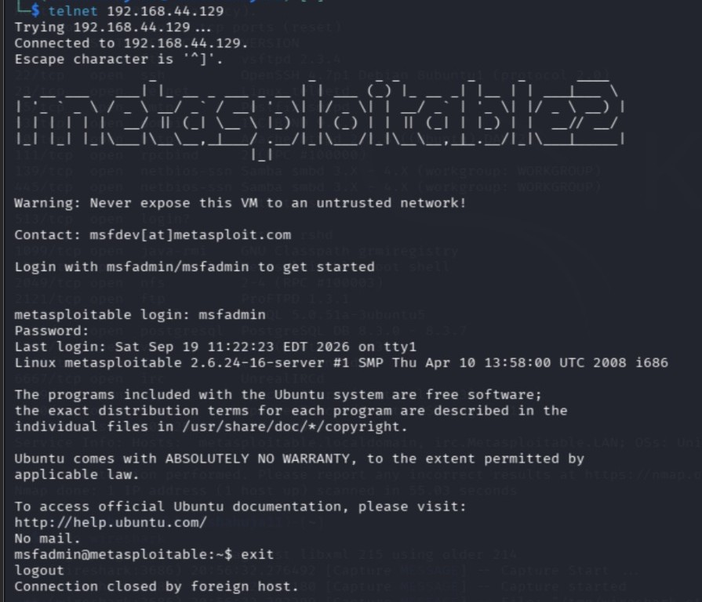
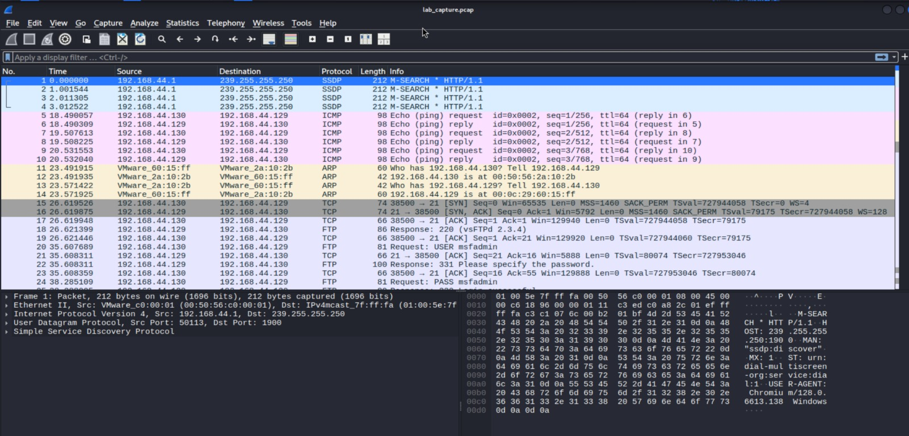
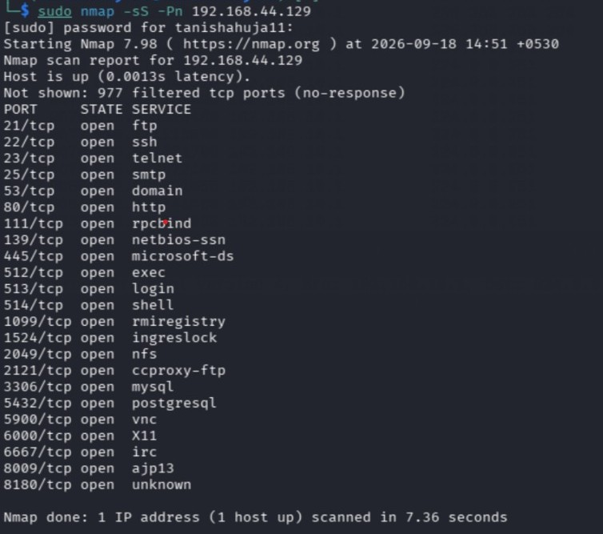

# Experiment 3: Basic Network Traffic Analysis with Wireshark

---

## Aim

To capture and analyse live network packets using Wireshark in a controlled lab environment, apply display filters to isolate protocol-specific traffic (HTTP, FTP, Telnet), and identify cleartext credentials and sensitive information transmitted over insecure protocols — demonstrating the critical role of network traffic analysis in both offensive reconnaissance and defensive monitoring.

---

## Requirements

| # | Component | Description |
|---|-----------|-------------|
| 1 | **Kali Linux** | Analysis workstation with Wireshark and Nmap pre-installed |
| 2 | **Wireshark** | Open-source network protocol analyser (v3.x or later) |
| 3 | **Metasploitable 2** | Intentionally vulnerable target VM running insecure services (FTP, Telnet, HTTP) |
| 4 | **VirtualBox / VMware** | Type-2 hypervisor for hosting both VMs |
| 5 | **Host-Only Adapter / Internal Network** | Isolated virtual network segment for safe traffic capture |

---

## Theory

### Wireshark and Packet Analysis Fundamentals

Wireshark is the world's foremost open-source network protocol analyser, used by security professionals, network engineers, and developers to capture, dissect, and inspect network traffic at the packet level. Built on the `libpcap` (Linux/macOS) and `Npcap` (Windows) capture libraries, Wireshark places the network interface into promiscuous mode, enabling it to capture all frames traversing the wire — not just those destined for the local host. Wireshark's dissector engine supports over 3,000 protocols, decomposing each packet from the Ethernet frame header through the IP, TCP/UDP, and application-layer headers into human-readable fields. Its Berkeley Packet Filter (BPF) capture filters and Wireshark Display Filters (WDF) provide powerful mechanisms to isolate specific traffic flows — for example, `ip.addr == 192.168.56.101` filters all packets to/from a specific host, while `ftp.request.command == "USER"` isolates FTP username transmissions.

### The Danger of Cleartext Protocols

Protocols such as FTP (RFC 959), Telnet (RFC 854), and unencrypted HTTP (RFC 2616) transmit authentication credentials and session data in plaintext over the network. This means any observer with access to the network path — whether through a compromised switch, ARP spoofing, a misconfigured SPAN port, or a shared broadcast domain — can trivially extract usernames, passwords, session tokens, and sensitive data directly from captured packets. FTP transmits `USER` and `PASS` commands as ASCII strings; Telnet sends each keystroke as an individual packet, making full credential reconstruction possible through TCP stream reassembly. This experiment demonstrates exactly this risk: by generating FTP, Telnet, and HTTP traffic in a lab environment and analysing the captures, the inherent insecurity of these legacy protocols becomes immediately visible.

### Network Forensics and Incident Response Applications

In a defensive context, packet capture analysis (PCAP analysis) is a cornerstone of network forensics and incident response. Security analysts use tools like Wireshark, `tshark` (its command-line counterpart), and `tcpdump` to reconstruct attack timelines, identify lateral movement, detect data exfiltration, and extract indicators of compromise (IoCs) from network traffic. Saved `.pcap` or `.pcapng` files serve as forensic evidence, preserving the exact byte-level record of network communications. Wireshark's "Follow TCP Stream" feature is particularly valuable for reconstructing complete application-layer conversations, revealing the full sequence of commands and responses exchanged between client and server.

---

## Procedure

### Step 1: Verify Connectivity

First, verify connectivity between Kali Linux and the Metasploitable 2 machine using:

```bash
ping -c 3 192.168.56.101
```

A successful reply confirms that Kali Linux can communicate with the target machine.



---

### Step 2: Quick Port/Service Scan

Perform a quick port and service scan of the target using Nmap:

```bash
sudo nmap -sS -Pn 192.168.56.101
```

Observe the open ports and services identified on the target machine.

> **Note:** The `-Pn` flag skips host discovery and treats the target as online, proceeding directly to port scanning. Combined with `-sS` (SYN stealth scan), this rapidly enumerates open ports including FTP (21), Telnet (23), and HTTP (80) — the services we will generate traffic against.



---

### Step 3: Start Wireshark Capture

Open Wireshark in Kali Linux and select the network interface connected to the lab network, such as `eth0` or `ens33`.

Start the packet capture and capture live network traffic.

> **Important:** Ensure the correct interface is selected — it must be the one on the Host-Only/Internal network where both VMs communicate. Wireshark will set the interface to promiscuous mode, allowing capture of all traffic on the segment.



---

### Step 4: Generate Lab Traffic

While Wireshark is capturing packets, generate network traffic from Kali Linux.

**HTTP GET:**
```bash
curl http://192.168.56.101/
```

**FTP Login:**
```bash
ftp 192.168.56.101
```

**Telnet Login:**
```bash
telnet 192.168.56.101
```

Run the interactions while Wireshark is capturing the traffic.

> **Note:** Each of these protocols transmits data in cleartext. The FTP client will send `USER` and `PASS` commands as unencrypted ASCII strings. Telnet transmits individual keystrokes in separate packets. HTTP sends request headers (including any `Authorization` headers) unencrypted.



---

### Step 5: Find Plaintext Information in Wireshark

Use the following Wireshark display filters to analyse the captured traffic.

**Traffic to/from target:**
```
ip.addr == 192.168.56.101
```

**FTP commands/credentials:**
```
ftp.request.command == "USER" || ftp.request.command == "PASS"
```

**Telnet traffic:**
```
telnet
```

**HTTP traffic:**
```
http
```

**HTTP Basic Authentication:**
```
http.authorization
```

Select the relevant packet and use:

> **Right Click → Follow → TCP Stream**

to examine the complete application-layer conversation.

> **Tip:** The "Follow TCP Stream" window colour-codes traffic by direction: **red** for client-to-server and **blue** for server-to-client, making it easy to trace the full authentication exchange and identify transmitted credentials.



---

### Step 6: Save Capture and Export Evidence

Save the captured traffic in Wireshark using:

> **File → Save As**

Save the capture as:

```
lab_capture.pcap
```

The captured file can be kept as evidence for the lab report.

> **Note:** The `.pcap` file preserves the complete packet-level record of all captured traffic, including timestamps, source/destination addresses, and full payload data. This file format is compatible with Wireshark, `tshark`, `tcpdump`, NetworkMiner, and most SIEM platforms for further analysis.



---

## Key Observations

| # | Observation | Detail |
|---|-------------|--------|
| 1 | **FTP Credential Exposure** | FTP `USER` and `PASS` commands were transmitted in plaintext and were directly visible in the packet payload |
| 2 | **Telnet Keystroke Visibility** | Individual keystrokes (including username and password characters) were captured as separate Telnet packets, fully reconstructable via TCP stream reassembly |
| 3 | **HTTP Request Inspection** | HTTP GET requests and response headers were captured unencrypted, including server banners revealing software versions |
| 4 | **Protocol Identification** | Wireshark's dissectors automatically classified packets by protocol (TCP, FTP, Telnet, HTTP), enabling rapid filtering |
| 5 | **TCP Stream Reconstruction** | The "Follow TCP Stream" feature reconstructed complete client-server dialogues, showing the full authentication handshake |
| 6 | **No Encryption in Use** | None of the observed services employed TLS/SSL encryption, confirming the target's insecure default configuration |
| 7 | **Forensic Preservation** | The saved `.pcap` file retained full packet fidelity, suitable for evidentiary and forensic purposes |

---

## MITRE ATT&CK Mapping

| Technique ID | Technique Name | Tactic | Relevance |
|--------------|---------------|--------|-----------|
| **T1040** | Network Sniffing | Credential Access / Discovery | Wireshark capture of network traffic to extract credentials |
| **T1557** | Adversary-in-the-Middle | Credential Access / Collection | Interception of cleartext FTP/Telnet credentials on a shared network segment |
| **T1046** | Network Service Scanning | Discovery | Nmap scan to identify open ports and services before traffic generation |
| **T1552.006** | Unsecured Credentials: Group Policy Preferences | Credential Access | Analogous: credentials transmitted in cleartext over insecure protocols |
| **T1071.001** | Application Layer Protocol: Web Protocols | Command and Control | HTTP traffic analysis demonstrating cleartext application-layer communication |
| **T1005** | Data from Local System | Collection | Capture and export of network evidence (`.pcap` file) |

---

## Defensive Recommendations

| # | Recommendation | Priority |
|---|---------------|----------|
| 1 | **Eliminate Cleartext Protocols** — Replace FTP with SFTP/SCP, Telnet with SSH, and HTTP with HTTPS (TLS 1.2+) across all systems | Critical |
| 2 | **Enforce Encryption Policies** — Implement network security policies that prohibit the use of unencrypted authentication protocols; validate compliance with periodic scans | Critical |
| 3 | **Network Segmentation** — Isolate sensitive services into dedicated VLANs with switch port security enabled to prevent unauthorised sniffing from adjacent segments | High |
| 4 | **Implement 802.1X Port Authentication** — Use IEEE 802.1X Network Access Control (NAC) to authenticate devices before granting network access, reducing the risk of rogue sniffers | High |
| 5 | **Enable ARP Spoofing Detection** — Deploy Dynamic ARP Inspection (DAI) and DHCP Snooping on managed switches to prevent ARP-based traffic interception attacks | Medium |
| 6 | **Deploy Network Detection and Response (NDR)** — Use tools such as Zeek (Bro), Suricata, or commercial NDR platforms to continuously monitor for cleartext credential transmission and anomalous traffic patterns | Medium |
| 7 | **Implement Certificate-Based Authentication** — Where possible, replace password-based authentication with mutual TLS or SSH key-based authentication to eliminate credential exposure entirely | Medium |
| 8 | **Conduct Regular PCAP Audits** — Periodically capture and review network traffic to identify any remaining cleartext protocol usage or policy violations | Low |

---

## Result

The network traffic was successfully captured and analysed using Wireshark. HTTP, FTP, and Telnet traffic generated between Kali Linux and Metasploitable 2 was captured in real-time. Display filters were applied to isolate protocol-specific packets, and the "Follow TCP Stream" feature was used to reconstruct complete client-server conversations. Cleartext credentials transmitted via FTP and Telnet were directly visible in the captured packets, demonstrating the inherent insecurity of unencrypted protocols. The capture was saved as `lab_capture.pcap` for forensic preservation.

---

## Conclusion

This experiment provided a practical demonstration of network traffic analysis using Wireshark, highlighting both its offensive and defensive applications. From an offensive perspective, the exercise showed how an attacker with network access can trivially capture and extract credentials from cleartext protocols — a technique mapped to MITRE ATT&CK T1040 (Network Sniffing). From a defensive perspective, it reinforced the critical importance of encrypting all network communications: the transition from FTP to SFTP, Telnet to SSH, and HTTP to HTTPS is not merely a best practice but an essential security control. Wireshark's powerful filtering and stream reconstruction capabilities make it an indispensable tool for both penetration testers conducting network-level assessments and security analysts performing incident response and forensic investigations. The experiment underscores that any protocol transmitting credentials or sensitive data without encryption must be considered a critical vulnerability in modern network environments.
