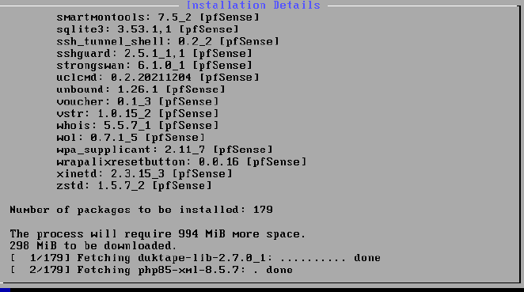
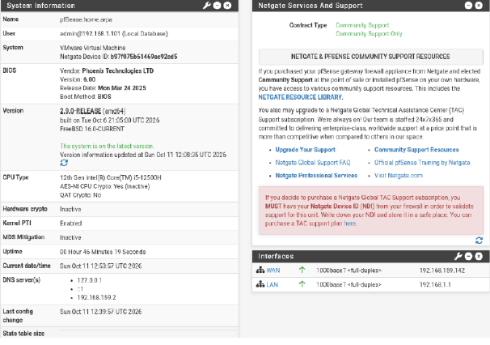
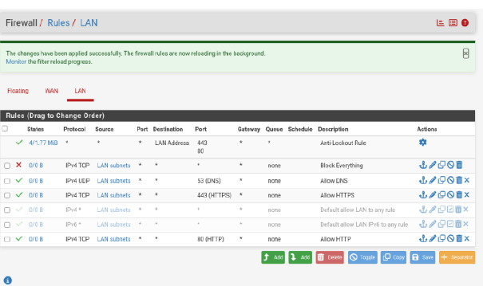
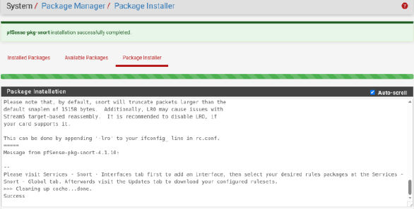
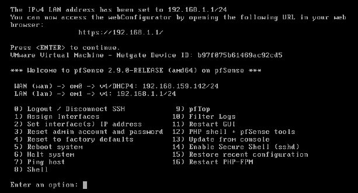
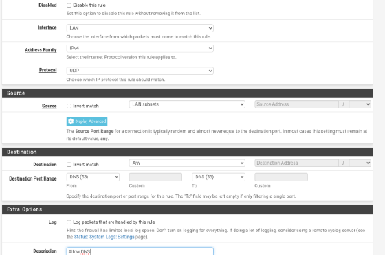
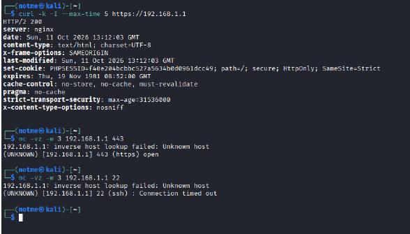
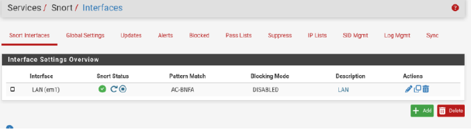
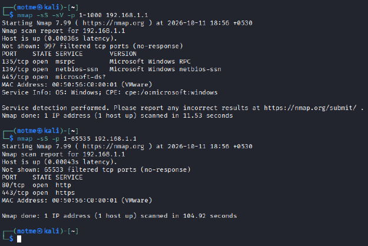

# Experiment 4 — Firewall & Intrusion Detection System Configuration with pfSense and Snort

---

## Aim

To deploy and configure **pfSense** as a perimeter firewall and **Snort** as a network-based Intrusion Detection System (IDS), then validate the detection pipeline by generating controlled attack traffic from Kali Linux against Metasploitable 2.

---

## Requirements

| Category | Component | Specification |
|---|---|---|
| **Attacker Machine** | Kali Linux | Latest rolling release, VirtualBox guest |
| **Target Machine** | Metasploitable 2 | Intentionally vulnerable Linux VM |
| **Firewall / IDS Appliance** | pfSense | Community Edition ISO (AMD64) |
| **Hypervisor** | Oracle VirtualBox | 6.x / 7.x with Extension Pack |
| **Networking** | VirtualBox Internal Network | Isolated LAN segment between all VMs |
| **IDS Engine** | Snort 3 (pfSense package) | Installed via pfSense Package Manager |

---

## Theory

### Firewall Fundamentals — Stateful Packet Inspection

A firewall is the foundational enforcement point that separates trusted (LAN) and untrusted (WAN) network zones. **pfSense**, built on FreeBSD and the `pf` packet filter, implements **stateful packet inspection (SPI)**. Unlike simple packet filters that evaluate each packet in isolation against static ACLs, SPI maintains a **state table** that tracks every TCP handshake, UDP pseudo-connection, and ICMP exchange. When a SYN packet is allowed outbound, the firewall creates a state entry; all subsequent packets belonging to that connection (SYN-ACK, ACK, data segments, FIN) are matched against the state table rather than re-evaluated against the ruleset, yielding both higher throughput and stronger security. pfSense exposes this capability through a web-based GUI where administrators define rules per interface (WAN, LAN, OPT) with match criteria including source/destination CIDR, port ranges, protocols, and schedules.

### Intrusion Detection — Signature-Based Analysis with Snort

While a firewall controls *which* traffic flows, an Intrusion Detection System answers a different question: *what is the traffic doing?* **Snort** operates as a signature-based NIDS that performs deep packet inspection (DPI) against a continuously updated rule library. Each rule specifies a protocol, flow direction, content pattern (byte strings, PCRE, flowbits), and metadata (CVE, Classtype, SID/GID). When Snort's detection engine matches a packet or reassembled stream against a rule, it generates an alert containing the rule message, classification, priority, and full packet payload. Deployed on the LAN interface of pfSense, Snort inspects every packet transiting the firewall, turning the appliance into a unified threat management (UTM) gateway. The combination of perimeter rule enforcement and deep content analysis provides **defence in depth** — a core principle of the NIST Cybersecurity Framework.

### Attack Surface & Detection Validation

In this lab, Kali Linux generates controlled reconnaissance traffic — ICMP probes (`ping`) and TCP SYN scans (`nmap -sS`) — against Metasploitable 2. The SYN scan sends TCP segments with only the SYN flag set to every target port; open ports respond with SYN-ACK, closed ports with RST. This half-open scanning technique is stealthier than a full connect scan because the three-way handshake is never completed. Snort's `scan` and `exploit` rule categories detect these patterns and generate alerts, proving the IDS pipeline is operational.

---

## Procedure

### Step 1 — Download and Prepare pfSense ISO

1. Navigate to the official **Netgate / pfSense** downloads portal.
2. Select the **AMD64 ISO** image intended for virtual machines.
3. Extract the archive (`.gz`) to obtain the raw `.iso` installer file.

> 📸 *Reference Screenshot*



---

### Step 2 — Create the pfSense Virtual Machine

1. Open **VirtualBox → Machine → New**.
2. Configure the VM parameters:

```
Name:     pfSense
Type:     BSD
Version:  FreeBSD (64-bit)
RAM:      1024–2048 MB
Disk:     16–20 GB (dynamically allocated VDI)
```

3. Under **Settings → Network**, configure two adapters:

| Adapter | Attachment | Purpose |
|---|---|---|
| **Adapter 1** | NAT / Bridged | WAN uplink (Internet) |
| **Adapter 2** | Internal Network (`lab-net`) | LAN segment for lab VMs |

4. Attach the pfSense ISO via **Settings → Storage → Controller: IDE → Optical Drive**.

---

### Step 3 — Install pfSense

1. Boot the pfSense VM.
2. Select **Install pfSense** at the boot menu.
3. Accept defaults → **Guided Disk Setup (UFS)** → confirm write.
4. On completion, remove the ISO from the virtual optical drive and **reboot**.

---

### Step 4 — Configure WAN and LAN Interfaces

1. At the pfSense console, identify interfaces:
   - `em0` → **WAN** (NAT adapter)
   - `em1` → **LAN** (Internal Network)
2. Assign a static LAN IP (e.g., `192.168.1.1/24`).
3. Ensure Kali Linux and Metasploitable 2 VMs are attached to the same Internal Network (`lab-net`) and configured within the `192.168.1.0/24` subnet.

> 📸 *pfSense Console — Interface IP Assignment*



---

### Step 5 — Access the pfSense Web Dashboard

From Kali Linux, open a browser and navigate to the pfSense LAN gateway:

```bash
# Open the pfSense web configurator
firefox https://192.168.1.1
```

Log in with default credentials (`admin` / `pfsense`) and complete the initial setup wizard.

> 📸 *pfSense Web Dashboard*



---

### Step 6 — Create Firewall Rules on the LAN Interface

1. Navigate to **Firewall → Rules → LAN**.
2. Add a rule to permit lab traffic:

| Field | Value |
|---|---|
| Action | **Pass** |
| Interface | LAN |
| Protocol | Any |
| Source | LAN net |
| Destination | Any |

3. Click **Save** → **Apply Changes**.

> 📸 *Firewall Rule Configuration*



---

### Step 7 — Verify Connectivity Through the Firewall

From Kali Linux, confirm routing through pfSense and reachability of the target:

```bash
# Verify default gateway
ip route

# Test connectivity to Metasploitable 2
ping -c 4 192.168.1.100
```

> 📸 *Kali Connectivity Test*



---

### Step 8 — Install Snort IDS on pfSense

1. Navigate to **System → Package Manager → Available Packages**.
2. Search for **Snort** and click **Install**.
3. After installation, go to **Services → Snort → Snort Interfaces**.
4. Add the **LAN** interface and configure:

| Setting | Value |
|---|---|
| Interface | LAN (`em1`) |
| Enable | ✅ |
| Send Alerts to System Log | ✅ |
| Rule Sets | Snort Community Rules (GPLv2) |

5. Under **LAN Categories**, enable:
   - `snort_scan.rules`
   - `snort_exploit.rules`
   - `snort_icmp.rules`
6. Click **Save** → **Start Snort** on the LAN interface.

> 📸 *Snort Installation via Package Manager*



> 📸 *Snort Interface Configuration*



---

### Step 9 — Generate Attack Traffic for Detection Validation

From Kali Linux, execute controlled reconnaissance against Metasploitable 2:

```bash
# ICMP Sweep — triggers icmp-info rules
ping -c 5 192.168.1.100

# TCP SYN Scan — triggers scan/portscan detection
sudo nmap -sS -T4 192.168.1.100

# Service Version Detection — triggers additional signatures
sudo nmap -sV -p 21,22,80,3306 192.168.1.100
```

> 📸 *Nmap Scan Execution*



---

### Step 10 — Analyse Snort Alerts

1. In pfSense, navigate to **Services → Snort → Alerts**.
2. Review the triggered alerts — each entry includes:
   - **SID** (Snort Rule ID)
   - **Classification** (e.g., *Attempted Information Leak*)
   - **Source / Destination IP and Port**
   - **Timestamp**
3. Verify that the SYN scan and ICMP traffic generated corresponding alerts.

> 📸 *Snort Alert Dashboard*



---

## Key Observations

| # | Observation | Detail |
|---|---|---|
| 1 | pfSense LAN rules allow controlled traffic flow | Pass rule on LAN net permits inter-VM communication |
| 2 | Snort detected ICMP probes | `ICMP PING` alerts with classification *Misc activity* |
| 3 | SYN scan triggered multiple alerts | `SCAN nmap SYN` and `portscan` preprocessor events fired |
| 4 | Alerts include full 5-tuple metadata | Source IP, Dest IP, Src Port, Dst Port, Protocol logged |
| 5 | No false negatives for active rules | All enabled rule categories matched expected traffic patterns |

---

## Result

The pfSense firewall was successfully deployed with a dual-interface (WAN/LAN) topology. Firewall rules were configured to permit controlled lab traffic. Snort IDS was installed, configured on the LAN interface, and validated by generating ICMP and TCP SYN scan traffic from Kali Linux. Snort correctly detected and alerted on all reconnaissance activity.

---

## Conclusion

This experiment demonstrated the deployment of a **defence-in-depth** architecture combining stateful firewall enforcement (pfSense) with signature-based intrusion detection (Snort). The pfSense firewall provided perimeter access control, while Snort's DPI engine identified malicious patterns within permitted traffic. This layered approach is fundamental to enterprise network security — firewalls alone cannot detect application-layer attacks, and IDS alone cannot block unauthorized flows. The combination delivers both **prevention** and **visibility**.

---

## MITRE ATT&CK Mapping

| Technique ID | Technique Name | Tactic | Relevance |
|---|---|---|---|
| **T1046** | Network Service Discovery | Discovery | `nmap -sS` SYN scan to enumerate open ports |
| **T1018** | Remote System Discovery | Discovery | ICMP ping sweep to identify live hosts |
| **T1595.001** | Active Scanning: Scanning IP Blocks | Reconnaissance | Systematic port/service enumeration |
| **T1590** | Gather Victim Network Information | Reconnaissance | Mapping network topology and services |

---

## Countermeasures / Defensive Recommendations

| # | Recommendation | Implementation |
|---|---|---|
| 1 | **Egress Filtering** | Restrict outbound traffic to only required ports/protocols; deny by default |
| 2 | **IDS → IPS Mode** | Enable Snort in *inline* (IPS) mode to actively block detected threats |
| 3 | **Rule Tuning** | Suppress false positives by tuning `threshold` and `suppress` directives per SID |
| 4 | **Log Forwarding (SIEM)** | Ship Snort alerts to a SIEM (e.g., Splunk, ELK) for centralised correlation |
| 5 | **Network Segmentation** | Place critical assets behind additional firewall zones (DMZ, OPT interfaces) |
| 6 | **Snort Rule Updates** | Schedule automatic rule updates (PulledPork / Oinkmaster) to maintain coverage |
| 7 | **Encrypted Traffic Inspection** | Deploy TLS inspection on pfSense for visibility into HTTPS traffic |

---

> **Disclaimer:** This experiment was conducted in an isolated virtual lab environment for educational purposes only. All traffic was generated between locally controlled VMs. Do not replicate these techniques on production networks without explicit authorisation.
