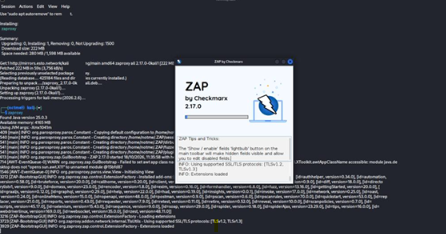
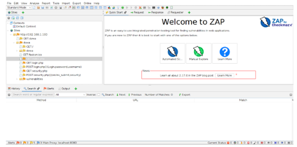
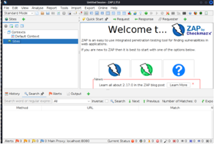
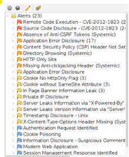
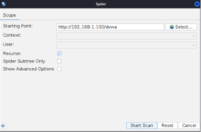
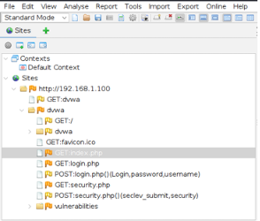
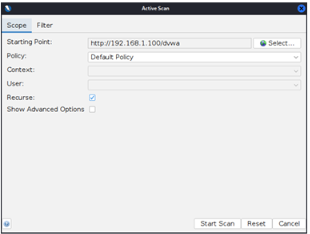
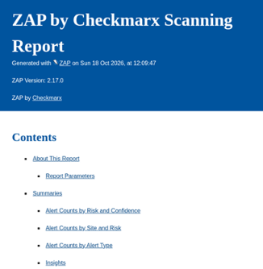
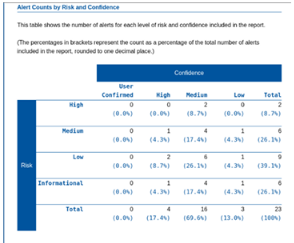

# Experiment 6 — Web Application Vulnerability Assessment with OWASP ZAP

---

## Aim

To perform an **automated vulnerability scan** of the **Damn Vulnerable Web Application (DVWA)** using **OWASP ZAP (Zed Attack Proxy)**, identify security weaknesses mapped to the OWASP Top 10, and generate a professional risk assessment report.

---

## Requirements

| Category | Component | Specification |
|---|---|---|
| **Attacker Machine** | Kali Linux | Rolling release with OWASP ZAP pre-installed |
| **Target Machine** | Metasploitable 2 | Hosts DVWA at `http://<target-ip>/dvwa` |
| **Scanning Tool** | OWASP ZAP | 2.x — open-source DAST (Dynamic Application Security Testing) proxy |
| **Hypervisor** | Oracle VirtualBox | 6.x / 7.x |
| **Networking** | Host-Only / Internal Network | Isolated segment — scanner and target on same subnet |
| **Browser** | Firefox (Kali) | Used for DVWA login and ZAP HUD integration |

---

## Theory

### Dynamic Application Security Testing (DAST)

**Dynamic Application Security Testing** analyses running web applications by sending crafted HTTP requests and evaluating the responses for symptoms of vulnerabilities. Unlike Static Application Security Testing (SAST), which reviews source code, DAST operates in a **black-box** or **grey-box** mode — it interacts with the application exactly as an attacker would, through the HTTP/HTTPS interface. This makes DAST effective at discovering runtime issues such as **SQL injection, Cross-Site Scripting (XSS), insecure authentication, session management flaws, and server misconfigurations**. DAST tools crawl (spider) the application to discover all reachable endpoints, then systematically inject malicious payloads and observe whether the application reflects, executes, or errors in ways that indicate a vulnerability.

### OWASP ZAP Architecture and Scanning Pipeline

**OWASP ZAP (Zed Attack Proxy)** is the world's most widely-used free DAST tool, maintained by the OWASP Foundation. ZAP operates as an **intercepting proxy** positioned between the browser and the target application. Its scanning pipeline consists of three phases: (1) **Spidering/Crawling** — ZAP's traditional spider follows HTML links, form actions, and JavaScript references to build a site tree of all discovered URLs; the AJAX Spider additionally renders JavaScript-heavy pages using a headless browser. (2) **Passive Scanning** — as pages are fetched, ZAP's passive scan rules analyse responses for issues that require no additional requests: missing security headers (`X-Content-Type-Options`, `Content-Security-Policy`), insecure cookie attributes, information disclosure in error messages, and server version banners. (3) **Active Scanning** — ZAP replays each discovered request with modified parameters, injecting attack payloads for SQL injection (`' OR 1=1 --`), reflected/stored XSS (`<script>alert(1)</script>`), path traversal (`../../etc/passwd`), command injection, and dozens of other attack classes. Each finding is assigned a **risk level** (High, Medium, Low, Informational) and a **confidence rating** (High, Medium, Low), and is mapped to the relevant **CWE (Common Weakness Enumeration)** identifier.

### DVWA as a Controlled Target

The **Damn Vulnerable Web Application (DVWA)** is a PHP/MySQL application intentionally designed with security flaws at configurable difficulty levels (Low, Medium, High, Impossible). It provides exercises for SQL Injection, Command Injection, XSS (Reflected, Stored, DOM), CSRF, File Inclusion, File Upload, and Brute Force — making it an ideal target for validating DAST tool effectiveness. Running on Metasploitable 2's Apache/PHP stack, DVWA presents a realistic attack surface that generates meaningful scan results without risking production systems.

---

## Procedure

### Step 1 — Virtual Machine Setup and Network Verification

1. Start both **Kali Linux** (attacker) and **Metasploitable 2** (target) VMs in VirtualBox.
2. Ensure both VMs are on the same **Host-Only** or **Internal Network** adapter.
3. Verify network connectivity from Kali:

```bash
# Check Kali IP address
ip addr show eth0
```

> 📸 *VM Setup and Network Configuration*



---

### Step 2 — Identify the Kali Linux IP Address

Record the attacker's IP address for reference:

```bash
# Display IP configuration
ip addr show eth0 | grep inet

# Expected output example:
# inet 192.168.56.10/24 brd 192.168.56.255 scope global eth0
```

> 📸 *Kali Linux IP Address*



---

### Step 3 — Identify the Target (Metasploitable 2) IP Address

From the Metasploitable 2 console, note the target IP:

```bash
# On Metasploitable 2
ifconfig eth0

# Or from Kali, discover the target via network scan
nmap -sn 192.168.56.0/24
```

> 📸 *Target IP Address*



---

### Step 4 — Test Connectivity Between Attacker and Target

Verify bidirectional connectivity:

```bash
# Ping the target from Kali
ping -c 4 192.168.56.100

# Verify the web server is reachable
curl -I http://192.168.56.100/
```

Confirm that the HTTP response returns `200 OK` or a valid status code, indicating the Apache web server on Metasploitable 2 is running.

> 📸 *Connectivity Verification*



---

### Step 5 — Access DVWA and Authenticate

1. Open Firefox on Kali Linux.
2. Navigate to the DVWA login page:

```
http://192.168.56.100/dvwa/login.php
```

3. Log in with default credentials:

| Field | Value |
|---|---|
| Username | `admin` |
| Password | `password` |

4. After login, navigate to **DVWA Security** and set the security level to **Low** for maximum scan coverage.

> 📸 *DVWA Login Page*



---

### Step 6 — Launch OWASP ZAP

Start OWASP ZAP from the Kali Linux applications menu or terminal:

```bash
# Launch ZAP from terminal
zaproxy &

# Or via Applications → Web Application Analysis → OWASP ZAP
```

1. On first launch, select **"Yes, I want to persist this session"** (or continue without saving for a one-time scan).
2. Familiarise yourself with the ZAP interface:
   - **Sites Tree** (left) — discovered URLs
   - **Request/Response Tabs** (right) — HTTP details
   - **Alerts Tab** (bottom) — vulnerability findings
   - **Spider/Active Scan controls** (toolbar)

> 📸 *OWASP ZAP Interface*



---

### Step 7 — Execute Automated Scan Against DVWA

1. In ZAP, click **Automated Scan** (or navigate to **Quick Start → Automated Scan**).
2. Enter the target URL:

```
http://192.168.56.100/dvwa/
```

3. Click **Attack** to initiate the scan.
4. ZAP will execute the following pipeline:
   - **Spider** — crawl all pages and discover endpoints
   - **Passive Scan** — analyse responses for misconfigurations
   - **Active Scan** — inject attack payloads into all parameters

5. Monitor progress via the **Active Scan** tab and the progress bar.

> ⚠️ **Note:** Active scanning against DVWA may take 10–30 minutes depending on the number of discovered endpoints and scan policy configuration.

> 📸 *Automated Scan in Progress*



---

### Step 8 — Analyse Vulnerability Results

Once the scan completes, review findings in the **Alerts** tab:

1. Alerts are grouped by **risk level**:

| Risk Level | Colour | Meaning |
|---|---|---|
| 🔴 **High** | Red | Exploitable vulnerabilities — immediate action required |
| 🟠 **Medium** | Orange | Significant risk — should be remediated |
| 🟡 **Low** | Yellow | Minor issues — best-practice improvements |
| 🔵 **Informational** | Blue | Non-exploitable observations |

2. Click each alert to inspect:
   - **Description** — what the vulnerability is
   - **URL** — affected endpoint
   - **Parameter** — vulnerable input field
   - **Attack** — payload that triggered the finding
   - **Evidence** — response content proving the vulnerability
   - **CWE ID** — Common Weakness Enumeration reference
   - **Solution** — recommended remediation

3. Common findings on DVWA (Security: Low):

| Vulnerability | Risk | CWE | Affected Endpoint |
|---|---|---|---|
| SQL Injection | 🔴 High | CWE-89 | `/dvwa/vulnerabilities/sqli/` |
| Cross-Site Scripting (Reflected) | 🔴 High | CWE-79 | `/dvwa/vulnerabilities/xss_r/` |
| Path Traversal | 🔴 High | CWE-22 | `/dvwa/vulnerabilities/fi/` |
| Command Injection | 🔴 High | CWE-78 | `/dvwa/vulnerabilities/exec/` |
| Missing Anti-CSRF Tokens | 🟠 Medium | CWE-352 | Multiple forms |
| Missing CSP Header | 🟠 Medium | CWE-693 | Application-wide |
| Cookie Without `Secure` Flag | 🟡 Low | CWE-614 | `PHPSESSID` cookie |
| Server Version Disclosure | 🟡 Low | CWE-200 | HTTP `Server` header |

> 📸 *Vulnerability Results — Alert Summary*



---

### Step 9 — Generate the ZAP Scan Report

1. Navigate to **Report → Generate Report** in ZAP's menu bar.
2. Select the report format:

| Format | Use Case |
|---|---|
| **HTML** | Human-readable — suitable for presentations and handoffs |
| **XML** | Machine-parseable — integration with CI/CD pipelines |
| **JSON** | API consumption and custom dashboard integration |
| **Markdown** | Documentation and version-controlled reports |

3. Choose **HTML** for this lab exercise.
4. Configure report options:
   - Include all risk levels (High through Informational)
   - Include request/response evidence
   - Include remediation recommendations
5. Save the report to the desired location:

```bash
# Example save path
~/Desktop/dvwa-zap-report.html
```

6. Open the generated report in Firefox to review the formatted findings.

> 📸 *ZAP Report Generation*



---

## Key Observations

| # | Observation | Detail |
|---|---|---|
| 1 | ZAP spider discovered all DVWA modules | Site tree populated with `sqli`, `xss_r`, `xss_s`, `fi`, `exec`, `upload`, etc. |
| 2 | Multiple High-risk SQL Injection findings | Active scanner confirmed injectable parameters with `' OR 1=1 --` payloads |
| 3 | Reflected XSS confirmed with script execution | ZAP injected `<script>alert(1)</script>` and detected reflection in response body |
| 4 | Missing security headers across application | No `Content-Security-Policy`, `X-Frame-Options`, or `X-Content-Type-Options` headers |
| 5 | Session cookies lack security attributes | `PHPSESSID` transmitted without `Secure`, `HttpOnly`, or `SameSite` flags |
| 6 | Server information disclosure | Apache version and PHP version exposed in HTTP response headers |
| 7 | Report provides actionable remediation | Each finding includes CWE reference, attack evidence, and fix recommendations |

---

## Result

OWASP ZAP successfully completed an automated vulnerability scan against DVWA hosted on Metasploitable 2. The scan identified multiple **High-risk** vulnerabilities including SQL Injection, Cross-Site Scripting (Reflected), Command Injection, and Path Traversal, along with **Medium** and **Low** risk findings related to missing security headers, CSRF protections, and insecure cookie configurations. A comprehensive HTML report was generated documenting all findings with risk classifications, CWE mappings, and remediation guidance.

---

## Conclusion

This experiment demonstrated the use of **OWASP ZAP** as a Dynamic Application Security Testing tool for identifying web application vulnerabilities. The automated scanning pipeline — spidering, passive analysis, and active injection — effectively uncovered critical security flaws in DVWA that correspond to multiple entries in the **OWASP Top 10** (A03:2021 Injection, A07:2021 XSS, A05:2021 Security Misconfiguration). The exercise highlights that automated DAST tools are essential components of a secure development lifecycle (SDLC), but should be complemented with manual testing, SAST, and security code reviews for comprehensive coverage. In production environments, ZAP can be integrated into CI/CD pipelines (via its API and CLI modes) to enforce security gates before deployment.

---

## MITRE ATT&CK Mapping

| Technique ID | Technique Name | Tactic | Relevance |
|---|---|---|---|
| **T1190** | Exploit Public-Facing Application | Initial Access | SQL Injection and Command Injection in DVWA |
| **T1059.004** | Command and Scripting Interpreter: Unix Shell | Execution | OS command injection via DVWA `exec` module |
| **T1189** | Drive-by Compromise | Initial Access | Reflected XSS delivering malicious scripts to users |
| **T1005** | Data from Local System | Collection | Path traversal to access server-side files (`/etc/passwd`) |
| **T1595.002** | Active Scanning: Vulnerability Scanning | Reconnaissance | ZAP's automated active scan methodology |
| **T1592** | Gather Victim Host Information | Reconnaissance | Server version disclosure via HTTP headers |

---

## Countermeasures / Defensive Recommendations

| # | Recommendation | Implementation |
|---|---|---|
| 1 | **Parameterised Queries / Prepared Statements** | Replace string concatenation in SQL queries with parameterised statements (PDO/MySQLi) to eliminate SQL Injection |
| 2 | **Output Encoding** | Apply context-aware output encoding (HTML entity, JavaScript, URL) to prevent XSS reflection |
| 3 | **Input Validation** | Implement server-side whitelist validation on all user-supplied inputs |
| 4 | **Content Security Policy (CSP)** | Deploy restrictive CSP headers (`default-src 'self'`) to mitigate XSS impact |
| 5 | **Security Headers** | Add `X-Frame-Options: DENY`, `X-Content-Type-Options: nosniff`, `Strict-Transport-Security` |
| 6 | **Anti-CSRF Tokens** | Implement synchroniser token pattern on all state-changing forms |
| 7 | **Secure Cookie Configuration** | Set `Secure`, `HttpOnly`, and `SameSite=Strict` flags on session cookies |
| 8 | **Server Hardening** | Disable server version disclosure (`ServerTokens Prod`, `expose_php = Off`) |
| 9 | **Web Application Firewall (WAF)** | Deploy ModSecurity with OWASP Core Rule Set (CRS) for runtime attack blocking |
| 10 | **CI/CD Security Integration** | Integrate ZAP into deployment pipelines via `zap-cli` or ZAP Docker for continuous scanning |

---

> **Disclaimer:** This experiment was conducted in a fully isolated virtual lab environment against an intentionally vulnerable application (DVWA) for educational purposes only. Never perform vulnerability scanning against systems without explicit written authorisation. Unauthorised scanning may violate computer crime laws.
