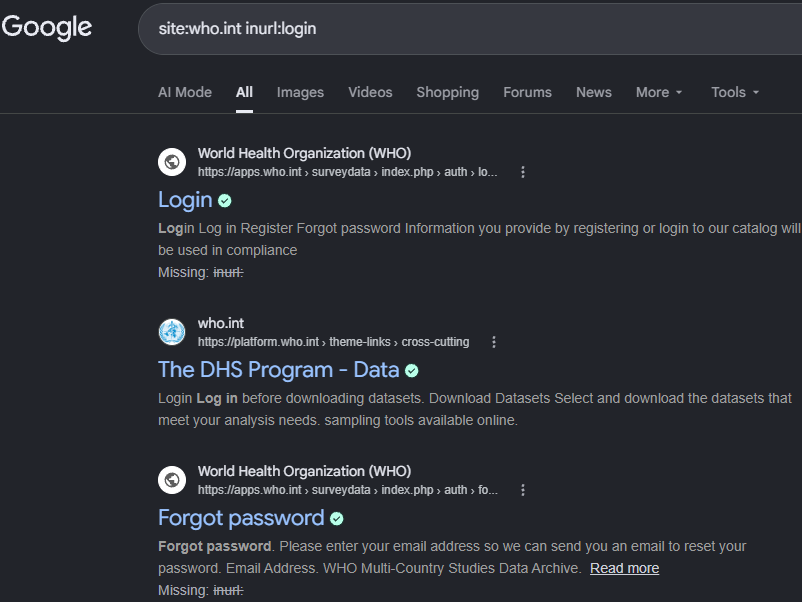
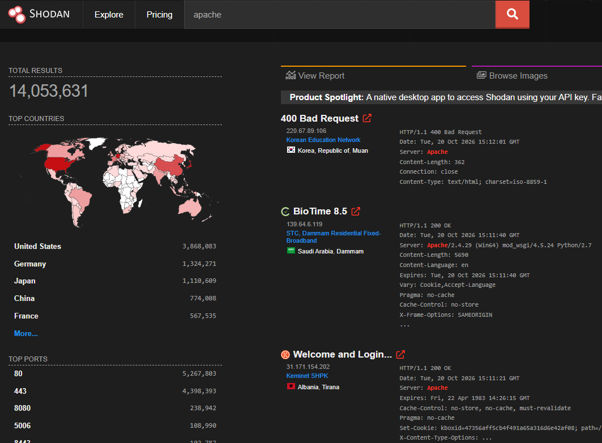
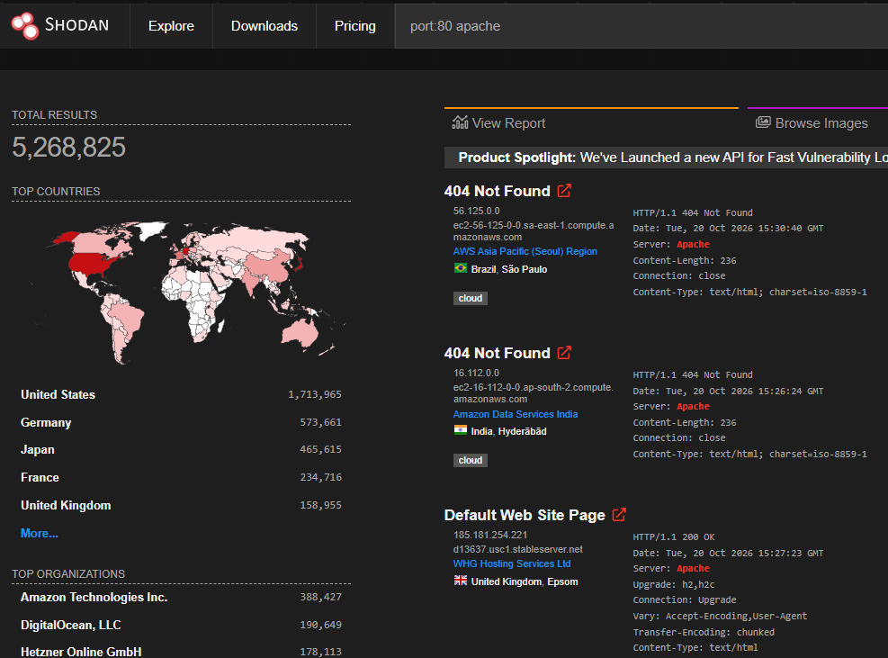
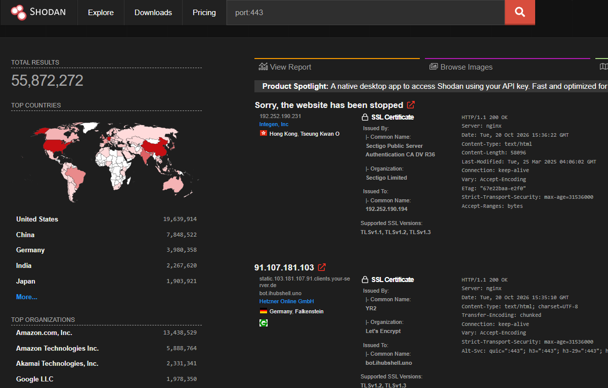
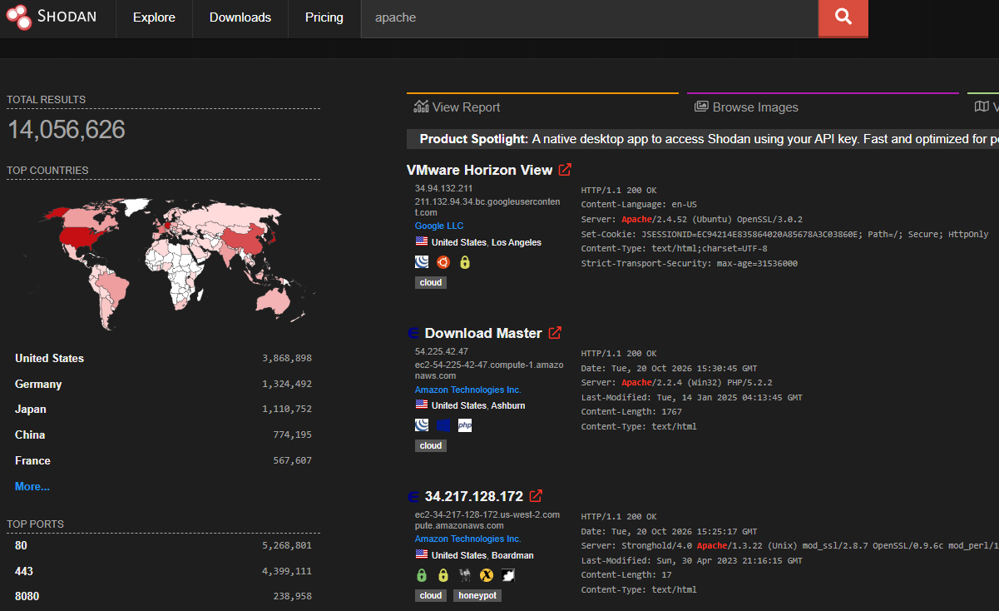

# 🔍 Experiment 7: OSINT Reconnaissance

## Open Source Intelligence Gathering Using Google Dorks and Shodan

---

## 📌 Aim

To perform passive reconnaissance on target systems and domains using Open Source Intelligence (OSINT) techniques — specifically Google Dorking and Shodan — to gather publicly available information without directly interacting with the target infrastructure.

---

## 🧰 Requirements

| Component         | Specification                                    |
| :----------------- | :----------------------------------------------- |
| **Host Machine**   | Any OS with a modern web browser                 |
| **Browser**        | Google Chrome / Firefox (latest version)         |
| **Search Engine**  | Google Search (https://www.google.com)            |
| **Shodan**         | Shodan account (https://www.shodan.io)            |
| **Network**        | Internet connectivity                            |
| **Optional Tools** | `shodan` CLI, `theHarvester`, `recon-ng`         |

---

## 📖 Theory

### Open Source Intelligence (OSINT)

Open Source Intelligence (OSINT) refers to the systematic collection, processing, and analysis of publicly available information from legal and ethical sources to produce actionable intelligence. In the context of cybersecurity and penetration testing, OSINT forms the first phase of the reconnaissance stage — gathering as much information as possible about a target without sending a single packet to its infrastructure. This passive approach significantly reduces the risk of detection while yielding invaluable data about an organization's digital footprint, exposed services, and potential attack surface.

### Google Dorking (Google Hacking)

Google Dorking leverages advanced search operators to craft precise queries that reveal information not intended for public consumption. Operators such as `site:`, `intitle:`, `inurl:`, `filetype:`, and `ext:` allow penetration testers to discover exposed configuration files, database dumps, login portals, directory listings, and sensitive documents indexed by Google's crawlers. The Google Hacking Database (GHDB), maintained by Offensive Security, catalogues thousands of proven dork queries categorized by vulnerability type. For instance, `filetype:sql "INSERT INTO" site:example.com` might expose SQL dump files, while `intitle:"Index of" /etc` could reveal directory listings on misconfigured web servers. Google's cache and Wayback Machine archives further extend OSINT capabilities by providing access to historical snapshots of web pages that have since been modified or taken offline.

### Shodan — The Search Engine for Internet-Connected Devices

Shodan continuously scans the entire IPv4 address space (and increasingly IPv6), indexing banners from services running on open ports. Unlike Google, which indexes web content, Shodan indexes service metadata — HTTP headers, SSL certificates, SSH banners, SNMP data, and protocol-specific responses. Penetration testers use Shodan to discover exposed services (e.g., unpatched Apache servers, open MongoDB instances, industrial control systems), map an organization's internet-facing infrastructure by ASN or IP range, and identify systems running vulnerable software versions. Shodan's filter syntax (`port:`, `org:`, `country:`, `product:`, `vuln:`) enables highly targeted searches that would otherwise require active port scanning with tools like Nmap — but without generating any traffic to the target.

---

## 🔬 Procedure

### Step 1 — Understanding Google Dork Operators

Familiarize yourself with the core Google Dork operators before crafting queries. Common operators include:

```
site:example.com          → Restrict results to a specific domain
intitle:"index of"        → Find pages with specific title text
inurl:admin               → Find URLs containing "admin"
filetype:pdf              → Search for specific file types
ext:sql | ext:bak         → Find files by extension
intext:"password"         → Search for keywords in page body
cache:example.com         → View Google's cached version of a page
```

> **⚠️ Note:** Google Dorking should only be performed against systems you are authorized to test. Unauthorized reconnaissance may violate laws such as the CFAA (US) or IT Act (India).


---

### Step 2 — Performing Google Dork Searches

Execute targeted dork queries against the authorized target domain. Start broad and progressively narrow the search:

```bash
# Find login portals
site:target.com inurl:login OR inurl:admin

# Discover exposed documents
site:target.com filetype:pdf OR filetype:xlsx OR filetype:docx

# Identify directory listings
site:target.com intitle:"Index of /"

# Search for configuration files
site:target.com ext:xml OR ext:conf OR ext:env OR ext:ini

# Find exposed credentials or sensitive strings
site:target.com intext:"username" intext:"password" filetype:log

# Discover subdomains via Google
site:*.target.com -www
```

Review each result carefully. Document discovered URLs, file types, exposed services, and any potentially sensitive information.



---

### Step 3 — Searching for the Target on Shodan

Navigate to [https://www.shodan.io](https://www.shodan.io) and log in. Use the search bar to query the target organization or IP range:

```bash
# Search by organization name
org:"Target Organization"

# Search by IP address
ip:192.168.1.0/24

# Search by hostname
hostname:target.com

# Search by ASN (Autonomous System Number)
asn:AS12345
```

Review the results overview — Shodan displays a summary of discovered hosts, open ports, operating systems, and geographic distribution.



---

### Step 4 — Analyzing Port 80 (HTTP) Services

Filter results to examine HTTP services running on port 80:

```bash
# Shodan filter for HTTP on port 80
org:"Target Organization" port:80
```

Click on individual results to inspect HTTP response headers, server banners, technologies detected, and any exposed web applications. Key information to document:

- **Server software** (e.g., Apache 2.4.41, Nginx 1.18.0)
- **Framework headers** (e.g., `X-Powered-By: PHP/7.4`)
- **Content Management Systems** detected
- **HTTP response codes** and redirects



---

### Step 5 — Analyzing Port 443 (HTTPS/TLS) Services

Filter results to examine HTTPS services and their SSL/TLS configurations:

```bash
# Shodan filter for HTTPS on port 443
org:"Target Organization" port:443

# Search for specific SSL vulnerabilities
org:"Target Organization" port:443 vuln:CVE-2014-0160
```

Inspect the SSL/TLS certificate details including:

- **Certificate issuer** and validity period
- **Subject Alternative Names (SANs)** — reveals additional hostnames and subdomains
- **TLS version** and cipher suites supported
- **Known vulnerabilities** (Heartbleed, POODLE, etc.)



---

### Step 6 — Searching for Specific Services (Apache)

Refine the search to find specific software products across the target's infrastructure:

```bash
# Find Apache web servers
org:"Target Organization" product:"Apache httpd"

# Find Apache servers with specific versions
org:"Target Organization" product:"Apache httpd" version:"2.4.49"

# Find potentially vulnerable Apache instances
product:"Apache httpd" vuln:CVE-2021-41773

# Search across broader scope
apache country:US port:80 city:"New York"
```

Document the Apache versions found, associated CVEs, and any misconfigurations (directory listing enabled, default pages exposed, `.htaccess` accessible).



---

## 📊 Key Observations

| # | Observation                          | Details                                                              |
|---|--------------------------------------|----------------------------------------------------------------------|
| 1 | Google Dork effectiveness            | Advanced operators reveal indexed content invisible to normal search |
| 2 | Exposed file types discovered        | Configuration files, backups, and documents found via `filetype:`    |
| 3 | Shodan service enumeration           | Identified open ports and service banners without active scanning    |
| 4 | HTTP server information leakage      | Server headers and banners disclose software versions                |
| 5 | TLS/SSL certificate intelligence     | SANs in certificates reveal additional subdomains and hostnames      |
| 6 | Specific product version discovery   | Apache (and other) service versions identifiable via Shodan filters  |
| 7 | No target interaction required       | All intelligence gathered passively — zero packets sent to target    |

---

## 🗺️ MITRE ATT&CK Mapping

| Technique ID | Technique Name                                      | Tactic          | Relevance                                                |
|:-------------|:----------------------------------------------------|:----------------|:---------------------------------------------------------|
| **T1593**    | Search Open Websites/Domains                        | Reconnaissance  | Google Dorking to find exposed content on target domains |
| **T1593.001**| Search Open Websites/Domains: Social Media          | Reconnaissance  | Discovering employee/org info via public sites           |
| **T1593.002**| Search Open Websites/Domains: Search Engines        | Reconnaissance  | Using Google advanced operators for indexed information  |
| **T1596**    | Search Open Technical Databases                     | Reconnaissance  | Shodan queries for service/banner enumeration            |
| **T1596.005**| Search Open Technical Databases: Scan Databases     | Reconnaissance  | Using Shodan's indexed scan data for target profiling    |
| **T1592**    | Gather Victim Host Information                      | Reconnaissance  | Identifying OS, software versions, and configurations    |
| **T1592.002**| Gather Victim Host Information: Software            | Reconnaissance  | Enumerating web server software and versions             |
| **T1590**    | Gather Victim Network Information                   | Reconnaissance  | Mapping IP ranges, ASN, open ports via Shodan            |
| **T1590.005**| Gather Victim Network Information: IP Addresses     | Reconnaissance  | Identifying target IP addresses through passive recon    |

---

## 🛡️ Countermeasures / Defensive Recommendations

| # | Recommendation                                           | Description                                                                                        |
|---|----------------------------------------------------------|----------------------------------------------------------------------------------------------------|
| 1 | **Minimize digital footprint**                           | Regularly audit publicly exposed information; remove unnecessary files from web servers            |
| 2 | **Restrict directory indexing**                          | Disable `Options Indexes` in Apache or `autoindex` in Nginx to prevent directory listing          |
| 3 | **Sanitize server headers**                              | Use `ServerTokens Prod` (Apache) or `server_tokens off` (Nginx) to suppress version information  |
| 4 | **Use robots.txt and meta tags wisely**                  | Prevent indexing of sensitive paths with `Disallow` directives (but don't rely on them alone)     |
| 5 | **Implement proper TLS configuration**                   | Use TLS 1.2+ with strong cipher suites; avoid exposing unnecessary SANs in certificates          |
| 6 | **Monitor Shodan and Censys**                            | Periodically search for your own organization to identify unintended exposures                    |
| 7 | **Deploy Web Application Firewalls (WAFs)**              | Block automated scanners and dork-based discovery attempts                                        |
| 8 | **Remove sensitive files from public directories**       | Ensure `.env`, `.git`, backup files, and config files are not accessible via HTTP                 |
| 9 | **Employee OPSEC training**                              | Train staff to avoid inadvertently publishing internal information on public platforms            |

---

## ✅ Result

Passive reconnaissance was successfully conducted using Google Dorks and Shodan. The following intelligence was gathered without sending any traffic to the target:

- **Google Dorking** revealed indexed pages, exposed documents, login portals, and directory listings associated with the target domain.
- **Shodan** identified internet-facing services, open ports (80, 443), server software versions (Apache), SSL/TLS certificate details, and potential vulnerabilities — all from passively indexed scan data.

---

## 📝 Conclusion

This experiment demonstrated the power and stealth of OSINT-based passive reconnaissance. Google Dorks and Shodan together provide a comprehensive view of an organization's external attack surface without generating any network traffic that the target could detect. The intelligence gathered in this phase — exposed services, software versions, leaked files, and infrastructure details — directly informs subsequent active scanning and exploitation phases of a penetration test. Defenders must proactively audit their public-facing assets and minimize information leakage to reduce the effectiveness of OSINT-driven reconnaissance.

---

> **⚠️ Disclaimer:** This experiment is conducted in a controlled lab environment for educational purposes only. Unauthorized reconnaissance against systems you do not own or have explicit permission to test is illegal and unethical.
